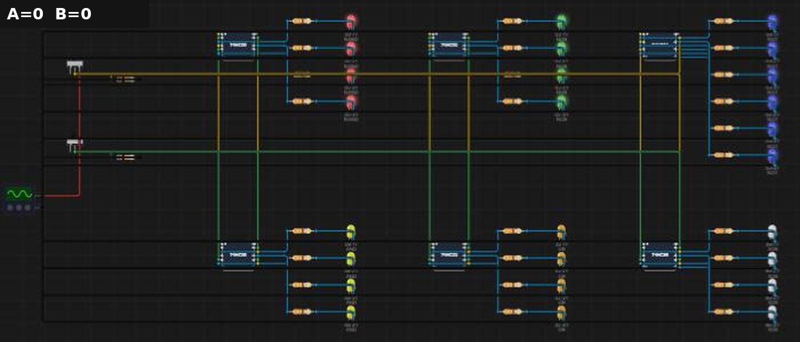
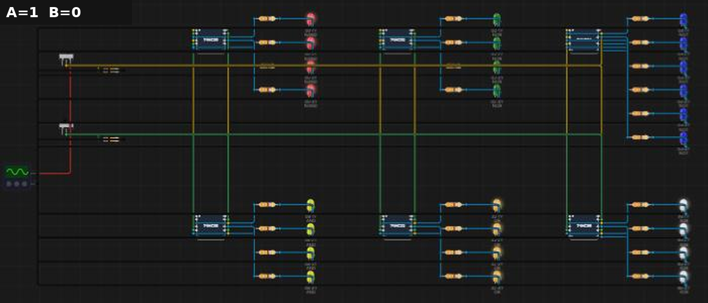
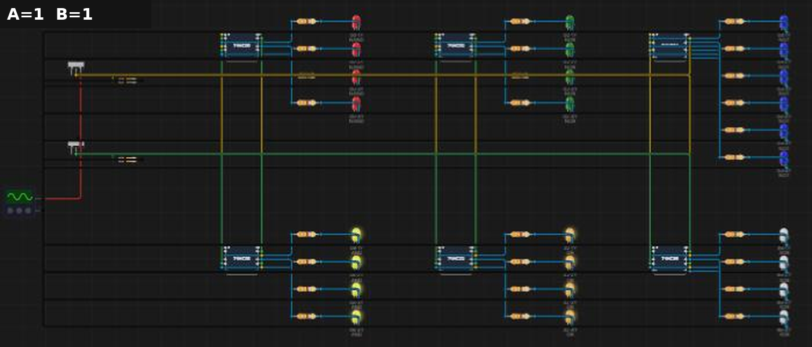

# B01 – Kiểm tra IC: xác minh bảng chân trị 74HC00/02/04/08/32/86

**Sinh viên:** Phạm Anh Quân – MSSV 2353011 · **Môn:** ĐATKLL – HCMUT

**Mức độ:** ★ · **Nhóm linh kiện:** Nhóm 1 (IC họ 74) · **Môi trường:** Velxio (mô phỏng SPICE)

| Thành phần | File |
|---|---|
| Project mô phỏng | `B01-kiem-tra-IC.vlx` (Velxio → File → Open project) |
| Báo cáo PDF | `B01-kiem-tra-IC.pdf` |
| Ảnh minh chứng | `img/B01_A?B?.png` |
| Script sinh mạch | `../tools/gen_b01.py` |

---

## 1. Mục tiêu

- Kiểm tra từng cổng của 6 IC 74HC00, 74HC02, 74HC04, 74HC08, 74HC32, 74HC86.
- Lập bảng chân trị đo được, so sánh với lý thuyết.
- Xác định chân nguồn, giải thích sơ đồ chân 74HC02, ghi ngưỡng logic từ datasheet.

## 2. Cơ sở lý thuyết

### 2.1. Chức năng và biểu thức Boolean

| IC | Cổng | Số cổng/IC | Biểu thức |
|---|---|---|---|
| 74HC00 | NAND 2 ngõ vào | 4 | Y = ¬(A·B) |
| 74HC02 | NOR 2 ngõ vào | 4 | Y = ¬(A + B) |
| 74HC04 | NOT | 6 | Y = ¬A |
| 74HC08 | AND 2 ngõ vào | 4 | Y = A·B |
| 74HC32 | OR 2 ngõ vào | 4 | Y = A + B |
| 74HC86 | XOR 2 ngõ vào | 4 | Y = A ⊕ B = A·¬B + ¬A·B |

NAND và NOR là **cổng vạn năng**: chỉ dùng một loại cũng dựng được mọi hàm logic (xem B02, B03).

### 2.2. Bảng chân trị lý thuyết

| A | B | NAND | NOR | NOT A | AND | OR | XOR |
|---|---|---|---|---|---|---|---|
| 0 | 0 | 1 | 1 | 1 | 0 | 0 | 0 |
| 0 | 1 | 1 | 0 | 1 | 0 | 1 | 1 |
| 1 | 0 | 1 | 0 | 0 | 0 | 1 | 1 |
| 1 | 1 | 0 | 0 | 0 | 1 | 1 | 0 |

### 2.3. Sơ đồ chân (DIP-14)

Tất cả 6 IC: **chân 14 = VCC, chân 7 = GND**.

| IC | Cấu hình chân |
|---|---|
| 74HC00, 08, 32, 86 | 1A=1, 1B=2 → 1Y=3 · 2A=4, 2B=5 → 2Y=6 · 3A=9, 3B=10 → 3Y=8 · 4A=12, 4B=13 → 4Y=11 |
| 74HC02 | **1Y=1** ← 1A=2, 1B=3 · **2Y=4** ← 2A=5, 2B=6 · 3A=8, 3B=9 → **3Y=10** · 4A=11, 4B=12 → **4Y=13** |
| 74HC04 | 1A=1→1Y=2 · 2A=3→2Y=4 · 3A=5→3Y=6 · 4A=9→4Y=8 · 5A=11→5Y=10 · 6A=13→6Y=12 |

**Vì sao 74HC02 khác 74HC00?** Ở 74HC02, ngõ ra của mỗi cổng nằm *trước* hai ngõ vào (1Y ở chân 1, 3Y ở chân 10…). Ở 74HC00, ngõ ra nằm *sau* (1Y ở chân 3). Đây là sơ đồ chân kế thừa từ IC TTL 7402 gốc của Texas Instruments. Họ 74HC giữ nguyên để **tương thích chân (pin-compatible)** với IC 74xx cùng số hiệu, cho phép thay thế trực tiếp trên mạch cũ. Hệ quả thực tế: không thể cắm 74HC02 vào socket của 74HC00 (hay ngược lại) mà giữ nguyên dây. Chân 1 và 3 đổi vai trò ngõ vào/ngõ ra, nên hai ngõ ra có thể bị nối với nhau (tranh chấp bus).

### 2.4. Ngưỡng logic (datasheet)

Nguồn: NXP *74HC00; 74HCT00 Quad 2-input NAND gate*, Product data sheet Rev. 7 (25/11/2015), bảng Static characteristics, cột 74HC, **VCC = 4,5 V**, giá trị đảm bảo trên dải −40 °C … +85 °C. Datasheet không lập bảng riêng cho 5,0 V. Ngưỡng ngõ vào CMOS tỉ lệ theo VCC (≈ 0,7·VCC / 0,3·VCC), nên ở 5 V có thể ước lượng V_IH ≈ 3,5 V, V_IL ≈ 1,5 V.

| Thông số | Điều kiện | Giá trị | Ý nghĩa |
|---|---|---|---|
| V_IH (min) | — | 3,15 V | Ngõ vào ≥ mức này chắc chắn được hiểu là 1 |
| V_IL (max) | — | 1,35 V | Ngõ vào ≤ mức này chắc chắn được hiểu là 0 |
| V_OH (min) | I_O = −20 µA | 4,4 V | Ngõ ra mức 1, tải CMOS |
| V_OH (min) | I_O = −4 mA | 3,84 V | Ngõ ra mức 1, có tải dòng |
| V_OL (max) | I_O = 20 µA | 0,1 V | Ngõ ra mức 0, tải CMOS |
| V_OL (max) | I_O = 4 mA | 0,33 V | Ngõ ra mức 0, có tải dòng |
| \|I_O\| (tuyệt đối) | — | 25 mA | Giới hạn không được vượt |

**Lề nhiễu (noise margin)**, tải 4 mA:
NM_H = V_OH − V_IH = 3,84 − 3,15 = **0,69 V**; NM_L = V_IL − V_OL = 1,35 − 0,33 = **1,02 V**.

### 2.5. Ngõ vào CMOS thả nổi và điện trở kéo

Ngõ vào CMOS có trở kháng rất lớn (dòng rò ≤ 1 µA). Nếu để hở, điện áp ngõ vào trôi theo nhiễu và điện tích tĩnh, có thể nằm giữa V_IL và V_IH. Khi đó cả transistor P và N cùng dẫn: dòng xuyên tăng, IC nóng, ngõ ra dao động. Vì vậy:

- Công tắc A, B nối VCC khi đóng, có **pull-down 10 kΩ** xuống GND để mức 0 xác định khi hở.
- Ngõ vào không dùng của IC phải nối cố định xuống GND hoặc lên VCC.

### 2.6. Điện trở hạn dòng cho LED

Với V_F (LED đỏ) ≈ 2 V và R = 330 Ω: I ≈ (5 − 2)/330 ≈ **9 mA**. Giá trị này dưới giới hạn tuyệt đối 25 mA nhưng lớn hơn 4 mA, mức mà datasheet đảm bảo V_OH/V_OL. Trên mạch thật, V_OH sẽ tụt dưới 3,84 V. Muốn bám sát datasheet thì dùng R ≈ 750 Ω – 1 kΩ (I ≈ 3–4 mA).

## 3. Thiết kế mạch mô phỏng

- **Nguồn:** Signal Generator, chế độ DC 5 V. Chân GND làm mass chung (nút 0 của SPICE).
- **Ngõ vào:** 2 slide switch A, B, mỗi cái có pull-down 10 kΩ.
- **Bus chung:** A (và B) nối song song vào *tất cả* ngõ vào cùng tên của 26 cổng. 74HC04 chỉ nhận A. Gạt 4 tổ hợp là đo xong cả 6 IC.
- **Ngõ ra:** mỗi Y → R 330 Ω → LED → GND. LED có nhãn dạng `00·1Y NAND`. Màu LED theo IC: 00 đỏ, 02 xanh lá, 04 xanh dương, 08 vàng, 32 cam, 86 trắng.
- **Chân 7 (GND)** của mỗi IC nối mass. **Chân 14 (VCC) không nối dây** (xem mục 5).

Thống kê: 6 IC, 2 công tắc, 28 điện trở, 26 LED; 63 linh kiện, 136 dây.

## 4. Kết quả mô phỏng

Đo bằng cách gạt công tắc trên canvas và đọc trạng thái 26 LED. Cả 4 cổng của mỗi IC (6 cổng với 74HC04) cho kết quả giống nhau.

| A | B | 00 NAND | 02 NOR | 04 NOT | 08 AND | 32 OR | 86 XOR |
|---|---|---|---|---|---|---|---|
| 0 | 0 | 1 | 1 | 1 | 0 | 0 | 0 |
| 0 | 1 | 1 | 0 | 1 | 0 | 1 | 1 |
| 1 | 0 | 1 | 0 | 0 | 0 | 1 | 1 |
| 1 | 1 | 0 | 0 | 0 | 1 | 1 | 0 |

**Kết luận:** cả 26 cổng khớp 100% với bảng lý thuyết ở mục 2.2 (20 cổng 2 ngõ vào × 4 tổ hợp, 6 cổng NOT × 2 mức của A).

Ảnh chụp canvas Velxio. Hàng trên từ trái sang: 74HC00 (đỏ), 74HC02 (xanh lá), 74HC04 (xanh dương). Hàng dưới: 74HC08 (vàng), 74HC32 (cam), 74HC86 (trắng). LED sáng có quầng phát sáng.

| A=0, B=0 | A=0, B=1 |
|---|---|
|  |  |
| **A=1, B=0** | **A=1, B=1** |
|  |  |

## 5. Khác biệt giữa mô phỏng và mạch thật

1. **74HC02 trong Velxio dùng sơ đồ chân giống 74HC00** (1A, 1B, 1Y ở chân 1, 2, 3). Trong mã nguồn Velxio, cả hai cùng dùng danh sách `QUAD_2IN_PINS` (`LogicICElements.ts`). Mô phỏng vì vậy *không* thể hiện sự khác biệt ở mục 2.3. Khi lắp mạch thật phải theo datasheet.
2. **Chân VCC được cấp nguồn ngầm.** Velxio tự nối mọi chân tên `VCC` vào nguồn nội `vcc_rail` 5 V. Nối thêm Signal Generator vào chân này tạo ra hai nguồn áp song song, SPICE báo `singular matrix: check node v_vcc_rail#branch`. Mạch thật bắt buộc phải nối chân 14 lên +5 V và đặt tụ 100 nF sát chân nguồn.
3. **Cổng là mô hình hành vi lý tưởng:** V_out = 0 V hoặc đúng 5 V, ngưỡng chuyển cố định 2,5 V, không có trễ lan truyền, không sụt áp theo tải. V_OH/V_OL và t_pd thực tế phải lấy từ datasheet.
4. **Tìm lỗi trong project của giảng viên:** cần file của giảng viên. Cách làm: đặt cùng tổ hợp A, B, cổng nào có LED khác các cổng cùng IC là cổng nối sai. Sau đó kiểm tra dây vào/ra của cổng đó.

## 6. Tài liệu tham khảo

- NXP Semiconductors, *74HC00; 74HCT00 Quad 2-input NAND gate*, Rev. 7, 2015.
- Datasheet 74HC02, 74HC04, 74HC08, 74HC32, 74HC86 (Nexperia / TI) cho sơ đồ chân.
- Velxio, mã nguồn `frontend/src/components/velxio-components/LogicICElements.ts`, `simulation/spice/NetlistBuilder.ts`.
