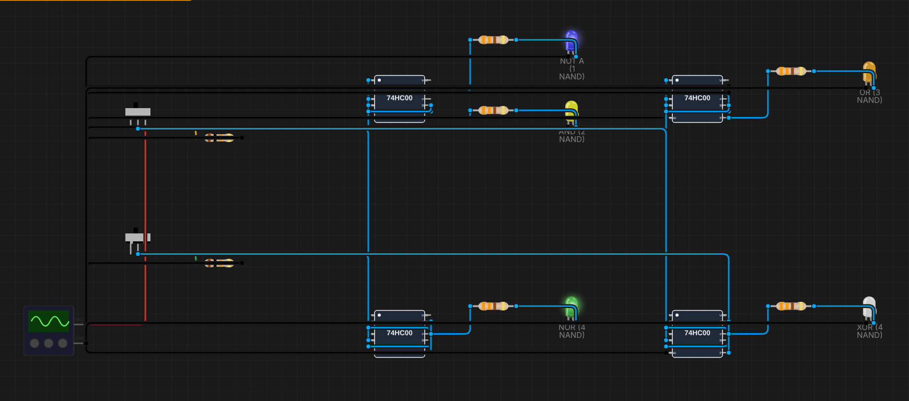
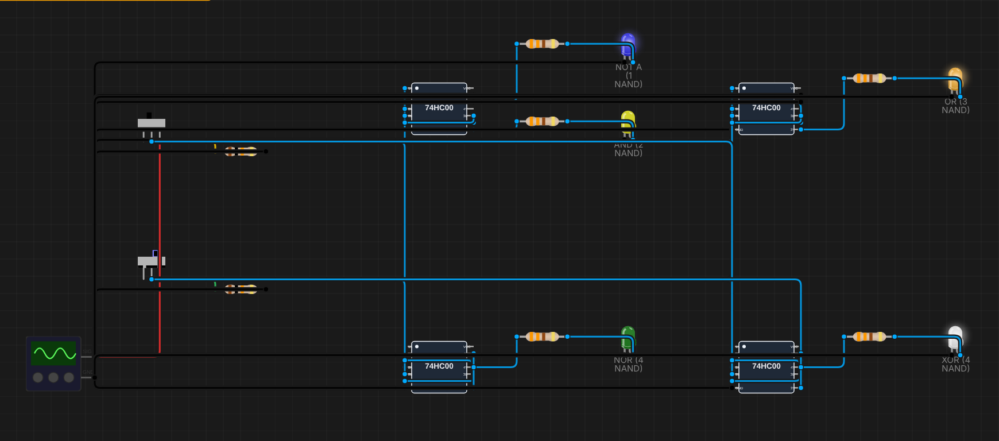
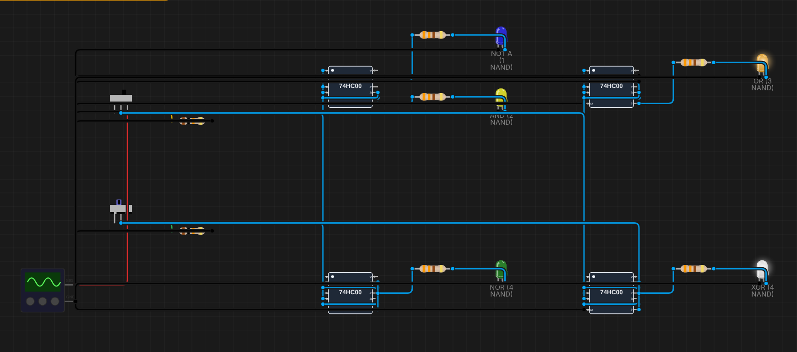
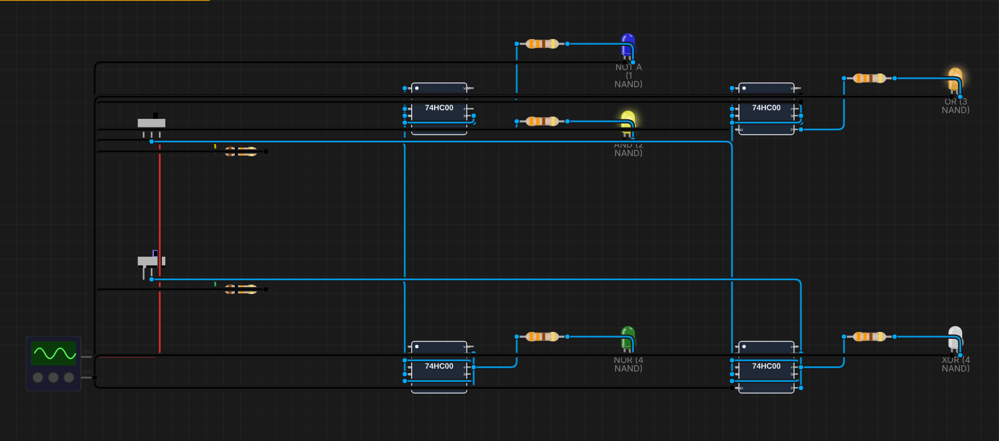

# B02 – NAND là cổng vạn năng

**Sinh viên:** Phạm Anh Quân – MSSV 2353011 · **Môn:** ĐATKLL – HCMUT

**Mức độ:** ★★ · **Nhóm linh kiện:** Nhóm 1 (IC họ 74) · **Môi trường:** Velxio (mô phỏng SPICE)

| Thành phần | File |
|---|---|
| Project mô phỏng | `B02-NAND-van-nang.vlx` (Velxio → File → Open project) |
| Báo cáo PDF | `B02-NAND-van-nang.pdf` |
| Ảnh minh chứng | `img/B02_A?B?.png` |
| Script sinh mạch | `../tools/gen_b02.py` |

---

## 1. Mục tiêu

- Chỉ dùng cổng NAND (74HC00), dựng lần lượt NOT, AND, OR, NOR, XOR.
- Chứng minh tương đương bằng đại số Boole, kiểm tra bằng bảng chân trị.
- XOR dùng đúng 4 NAND; đếm số NAND cho từng cổng và so sánh.

## 2. Cơ sở lý thuyết

Một tập cổng là **đầy đủ chức năng (functionally complete)** nếu dựng được mọi hàm Boole. {AND, OR, NOT} là tập đầy đủ. Nếu dựng được cả ba từ NAND thì NAND cũng đầy đủ, tức là **cổng vạn năng**.

Hai công cụ chính:

- Đặt hai ngõ vào bằng nhau: ¬(A·A) = ¬A.
- **De Morgan:** ¬(X·Y) = ¬X + ¬Y và ¬(X + Y) = ¬X·¬Y.

## 3. Thiết kế từng cổng

Ký hiệu NAND(X, Y) = ¬(X·Y).

### 3.1. NOT – 1 NAND

Nối chung hai ngõ vào: Y = NAND(A, A) = ¬(A·A) = **¬A**.

### 3.2. AND – 2 NAND

NAND rồi đảo lại bằng NAND thứ hai:
Y = NAND(N, N) với N = NAND(A, B) ⇒ Y = ¬N = ¬¬(A·B) = **A·B**.

### 3.3. OR – 3 NAND

Đảo từng ngõ vào rồi NAND:
Y = NAND(¬A, ¬B) = ¬(¬A·¬B) = ¬¬A + ¬¬B = **A + B** (De Morgan).

### 3.4. NOR – 4 NAND

Thêm một NAND làm cổng đảo sau mạch OR: Y = NAND(O, O) = ¬(A + B).

### 3.5. XOR – 4 NAND (phương án tối thiểu)

```
N1 = NAND(A, B)
N2 = NAND(A, N1)
N3 = NAND(B, N1)
Y  = NAND(N2, N3)
```

Chứng minh:

- N2 = ¬(A·¬(A·B)) = ¬(A·(¬A + ¬B)) = ¬(A·¬A + A·¬B) = ¬(A·¬B)
- N3 = ¬(B·¬(A·B)) = ¬(¬A·B) (đối xứng)
- Y = ¬(N2·N3) = ¬N2 + ¬N3 = **A·¬B + ¬A·B = A ⊕ B**

Mấu chốt là dùng chung N1 = NAND(A, B) cho cả hai nhánh, thay cho hai cổng NOT riêng. Cách "thẳng" theo biểu thức A·¬B + ¬A·B cần 2 NOT + 2 NAND + 1 NAND (OR dạng NAND–NAND) = 5 NAND.

### 3.6. Bảng so sánh số cổng

| Cổng | Biểu thức | Số NAND | Số IC 74HC00 (4 cổng/IC) |
|---|---|---|---|
| NOT | ¬A | 1 | 1/4 |
| AND | A·B | 2 | 1/2 |
| OR | A + B | 3 | 3/4 |
| NOR | ¬(A + B) | 4 | 1 |
| XOR | A ⊕ B | 4 | 1 |
| **Tổng** | | **14** | **4 IC** (dư 2 cổng) |

Nhận xét: NAND dựng AND và NOT rẻ (1–2 cổng), nhưng OR/NOR tốn hơn (3–4 cổng) vì phải đảo từng ngõ vào. Đề ghi "2 × 74HC00", đủ khi dựng **lần lượt** từng cổng (cổng tốn nhất cần 4 NAND = 1 IC). Trong project, cả 5 cổng được dựng **đồng thời** trên 4 IC để chỉ cần gạt 4 tổ hợp A, B là kiểm tra xong tất cả.

## 4. Thiết kế mạch mô phỏng

- **Nguồn:** Signal Generator chế độ DC 5 V (giống B01).
- **Ngõ vào:** 2 slide switch A, B, mỗi cái có pull-down 10 kΩ; A, B nối song song vào cả 4 IC.
- **Phân bổ cổng** (mỗi chức năng một IC riêng để dễ đếm):

| IC | Cổng 1 | Cổng 2 | Cổng 3 | Cổng 4 | LED |
|---|---|---|---|---|---|
| U1 | NOT: (A, A) | N = (A, B) | AND: (N, N) | không dùng | NOT A (xanh dương), AND (vàng) |
| U2 | ¬A: (A, A) | ¬B: (B, B) | OR: (¬A, ¬B) | không dùng | OR (cam) |
| U3 | ¬A: (A, A) | ¬B: (B, B) | O: (¬A, ¬B) | NOR: (O, O) | NOR (xanh lá) |
| U4 | N1: (A, B) | N2: (A, N1) | N3: (B, N1) | XOR: (N2, N3) | XOR (trắng) |

- **Cổng không dùng** (U1, U2 cổng 4): hai ngõ vào nối GND, tránh ngõ vào CMOS thả nổi (xem B01 mục 2.5).
- **Ngõ ra:** Y → R 330 Ω → LED → GND. Chân 7 nối mass, chân 14 để Velxio cấp ngầm (B01 mục 5).

Thống kê: 4 IC, 2 công tắc, 7 điện trở, 5 LED; 19 linh kiện, 57 dây.

## 5. Kết quả mô phỏng

Kết quả đọc từ trạng thái LED trên canvas khi gạt lần lượt 4 tổ hợp A, B (1 = LED sáng):

| A | B | NOT A | AND | OR | NOR | XOR |
|---|---|---|---|---|---|---|
| 0 | 0 | 1 | 0 | 0 | 1 | 0 |
| 0 | 1 | 1 | 0 | 1 | 0 | 1 |
| 1 | 0 | 0 | 0 | 1 | 0 | 1 |
| 1 | 1 | 0 | 1 | 1 | 0 | 0 |

**Kết luận:** cả 5 cổng dựng từ NAND khớp 100% với bảng chân trị lý thuyết của NOT, AND, OR, NOR, XOR.

Ảnh chụp canvas Velxio. Hàng trên: U1 (NOT A xanh dương, AND vàng), U2 (OR cam). Hàng dưới: U3 (NOR xanh lá), U4 (XOR trắng). Công tắc A ở trên, B ở dưới; LED sáng có quầng phát sáng.

| A=0, B=0 | A=0, B=1 |
|---|---|
|  |  |
| **A=1, B=0** | **A=1, B=1** |
|  |  |

## 6. Ghi chú về Velxio

1. **id của LED phải viết thường.** Ngspice đổi tên nút sang chữ thường, nên LED có id chứa chữ hoa (ví dụ `ledNOT`) không bao giờ sáng dù ngõ ra đúng. Script `tools/vlx.py` tự đổi id LED sang chữ thường.
2. Cổng trong Velxio là mô hình lý tưởng, không có trễ. Trên mạch thật, XOR 4 NAND có đường dài nhất qua 3 cổng (N1 → N2 → Y), trễ ≈ 3 × t_pd của 74HC00. Trong lúc A, B đổi, ngõ ra có thể có xung nhiễu (glitch) ngắn.

## 7. Tài liệu tham khảo

- M. Morris Mano, *Digital Design*, chương 2–3 (cổng vạn năng, De Morgan).
- NXP Semiconductors, *74HC00; 74HCT00 Quad 2-input NAND gate*, Rev. 7, 2015.
