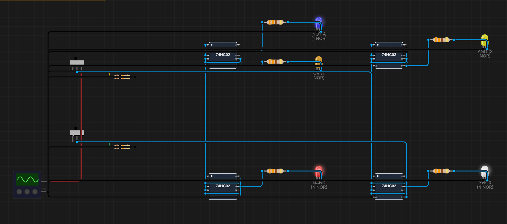
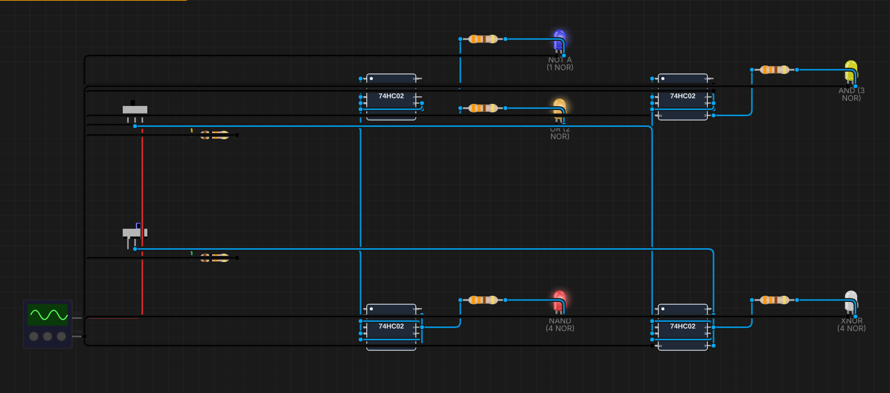
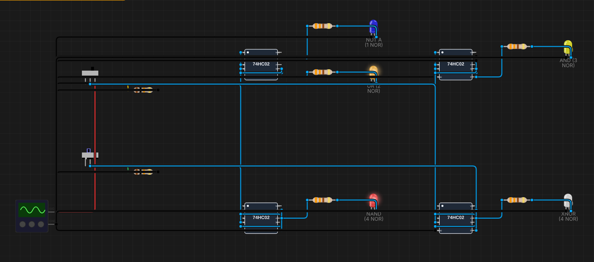
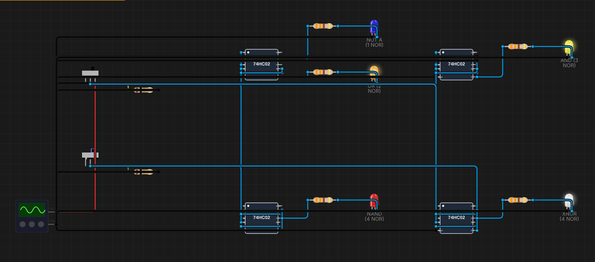

# B03 – NOR là cổng vạn năng

**Sinh viên:** Phạm Anh Quân – MSSV 2353011 · **Môn:** ĐATKLL – HCMUT

**Mức độ:** ★★ · **Nhóm linh kiện:** Nhóm 1 (IC họ 74) · **Môi trường:** Velxio (mô phỏng SPICE)

| Thành phần | File |
|---|---|
| Project mô phỏng | `B03-NOR-van-nang.vlx` (Velxio → File → Open project) |
| Báo cáo PDF | `B03-NOR-van-nang.pdf` |
| Ảnh minh chứng | `img/B03_A?B?.png` |
| Script sinh mạch | `../tools/gen_b03.py` |

---

## 1. Mục tiêu

- Chỉ dùng cổng NOR (74HC02), dựng NOT, OR, AND, NAND và XNOR.
- XNOR dùng tối thiểu 4 NOR.
- So sánh với B02, nhận xét khi nào chọn thiết kế toàn NAND, khi nào toàn NOR.

## 2. Cơ sở lý thuyết: nguyên lý đối ngẫu

**Nguyên lý đối ngẫu (duality):** đổi AND ↔ OR và 0 ↔ 1 trong một đẳng thức Boole đúng thì được một đẳng thức cũng đúng. NAND và NOR là cặp đối ngẫu, nên mạch toàn NOR có được bằng cách lấy mạch toàn NAND ở B02 rồi thay mỗi NAND bằng NOR. Hàm nhận được là **đối ngẫu** của hàm cũ:

| Mạch B02 (NAND) | Hàm | Cùng cấu trúc với NOR | Hàm |
|---|---|---|---|
| NAND(A, A) | NOT | NOR(A, A) | NOT |
| NAND(NAND(A,B), …) | AND | NOR(NOR(A,B), …) | OR |
| NAND(¬A, ¬B) | OR | NOR(¬A, ¬B) | AND |
| 4 NAND | NOR | 4 NOR | NAND |
| 4 NAND | XOR | 4 NOR | XNOR |

Vì vậy đề yêu cầu XNOR (không phải XOR): XNOR là đối ngẫu của XOR, cũng chỉ cần 4 cổng.

## 3. Thiết kế từng cổng

Ký hiệu NOR(X, Y) = ¬(X + Y).

### 3.1. NOT – 1 NOR

Y = NOR(A, A) = ¬(A + A) = **¬A**.

### 3.2. OR – 2 NOR

O = NOR(A, B); Y = NOR(O, O) = ¬O = **A + B**.

### 3.3. AND – 3 NOR

Y = NOR(¬A, ¬B) = ¬(¬A + ¬B) = ¬¬A·¬¬B = **A·B** (De Morgan).

### 3.4. NAND – 4 NOR

Thêm một NOR làm cổng đảo sau mạch AND: Y = NOR(X, X) = ¬(A·B).

### 3.5. XNOR – 4 NOR (phương án tối thiểu)

```
N1 = NOR(A, B)
N2 = NOR(A, N1)
N3 = NOR(B, N1)
Y  = NOR(N2, N3)
```

Chứng minh:

- N2 = ¬(A + ¬(A + B)) = ¬A·(A + B) = ¬A·A + ¬A·B = ¬A·B
- N3 = ¬(B + ¬(A + B)) = A·¬B (đối xứng)
- Y = ¬(N2 + N3) = ¬(¬A·B + A·¬B) = ¬(A ⊕ B) = **A ⊙ B (XNOR)**

### 3.6. So sánh với B02

| Cổng | Số NAND (B02) | Số NOR (B03) |
|---|---|---|
| NOT | 1 | 1 |
| AND | 2 | 3 |
| OR | 3 | 2 |
| NAND | 1 | 4 |
| NOR | 4 | 1 |
| XOR | 4 | 5 (XNOR + NOT) |
| XNOR | 5 (XOR + NOT) | 4 |

Hai bảng đối xứng nhau: thứ gì NAND làm rẻ thì NOR làm đắt, và ngược lại.

## 4. Khi nào chọn toàn NAND, khi nào toàn NOR?

- **Theo dạng biểu thức:** hàm viết ở dạng **tổng các tích (SOP)** chuyển thẳng sang mạch hai tầng **NAND–NAND** (thay mọi AND và OR bằng NAND). Hàm ở dạng **tích các tổng (POS)** chuyển thẳng sang **NOR–NOR**. Chọn dạng có ít số hạng hơn trên bìa Karnaugh (nhóm 1 → SOP/NAND, nhóm 0 → POS/NOR).
- **Theo công nghệ:** trong CMOS, NAND có 2 nMOS **nối tiếp** và 2 pMOS song song; NOR thì ngược lại, 2 **pMOS nối tiếp**. pMOS dẫn kém nMOS khoảng 2–3 lần, nên NOR cùng kích thước có sườn lên chậm hơn hoặc phải làm transistor to hơn. Vì vậy thư viện cell và FPGA/ASIC thường ưu tiên NAND. NOR hợp với mạch có nhiều điều kiện "tất cả đều 0" (ví dụ phát hiện bằng 0, SR latch tích cực mức cao).
- **Theo linh kiện có sẵn:** trên bo mạch thật, chọn loại cổng mà mạch đã có IC dư cổng để khỏi thêm IC.

## 5. Thiết kế mạch mô phỏng

Bố cục giống B02 (A, B dùng chung, pull-down 10 kΩ, Y → 330 Ω → LED):

| IC | Cổng 1 | Cổng 2 | Cổng 3 | Cổng 4 | LED |
|---|---|---|---|---|---|
| u1 | NOT: (A, A) | O = (A, B) | OR: (O, O) | không dùng | NOT A (xanh dương), OR (cam) |
| u2 | ¬A: (A, A) | ¬B: (B, B) | AND: (¬A, ¬B) | không dùng | AND (vàng) |
| u3 | ¬A | ¬B | X: (¬A, ¬B) | NAND: (X, X) | NAND (đỏ) |
| u4 | N1: (A, B) | N2: (A, N1) | N3: (B, N1) | XNOR: (N2, N3) | XNOR (trắng) |

Cổng không dùng nối hai ngõ vào xuống GND. Thống kê: 4 IC, 2 công tắc, 7 điện trở, 5 LED; 19 linh kiện, 57 dây.

**Sơ đồ chân 74HC02.** IC thật có ngõ ra ở chân 1, 4, 10, 13 (1Y=1, 1A=2, 1B=3 …), khác 74HC00. Velxio lại dùng chung sơ đồ chân với 74HC00 (đã ghi ở B01 mục 5). Project nối dây theo **tên chân** (1A, 1B, 1Y …) nên chạy đúng trong Velxio. Khi lắp mạch thật, phải tra datasheet 74HC02 để đổi sang số chân thật.

## 6. Kết quả mô phỏng

Kết quả đọc từ trạng thái LED khi gạt 4 tổ hợp A, B (1 = LED sáng):

| A | B | NOT A | OR | AND | NAND | XNOR |
|---|---|---|---|---|---|---|
| 0 | 0 | 1 | 0 | 0 | 1 | 1 |
| 0 | 1 | 1 | 1 | 0 | 1 | 0 |
| 1 | 0 | 0 | 1 | 0 | 1 | 0 |
| 1 | 1 | 0 | 1 | 1 | 0 | 1 |

**Kết luận:** cả 5 cổng dựng từ NOR khớp 100% với bảng chân trị lý thuyết.

Ảnh chụp canvas. Hàng trên: u1 (NOT A, OR), u2 (AND). Hàng dưới: u3 (NAND), u4 (XNOR).

| A=0, B=0 | A=0, B=1 |
|---|---|
|  |  |
| **A=1, B=0** | **A=1, B=1** |
|  |  |

## 7. Tài liệu tham khảo

- M. Morris Mano, *Digital Design*, chương 2–3 (đối ngẫu, mạch NAND–NAND và NOR–NOR).
- Nexperia, *74HC02; 74HCT02 Quad 2-input NOR gate*, datasheet (sơ đồ chân).
