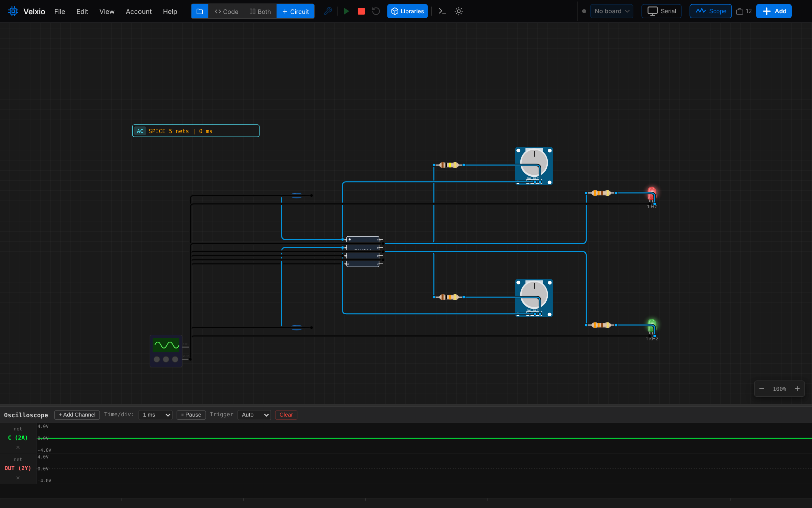
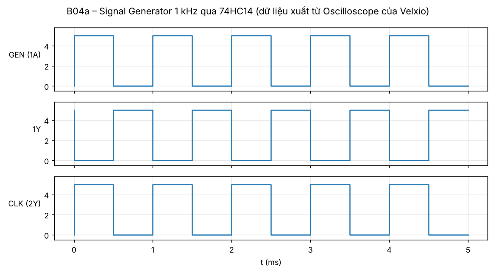
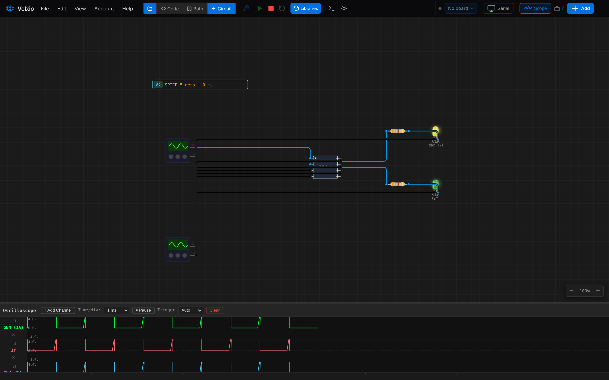
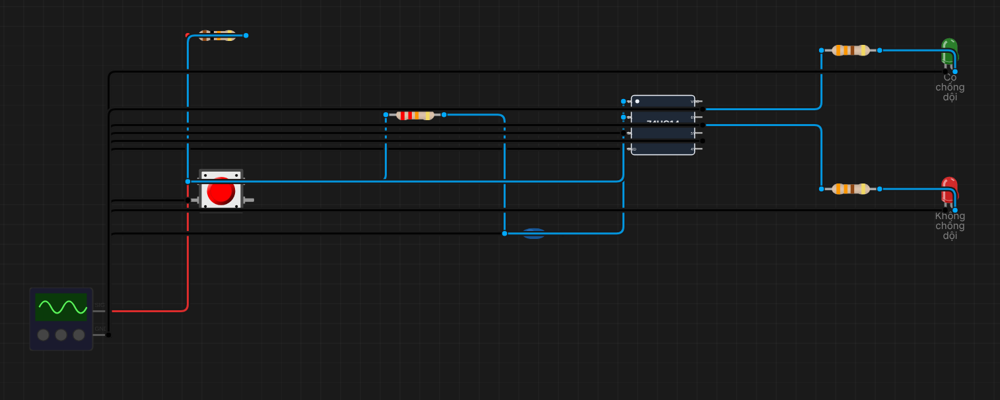
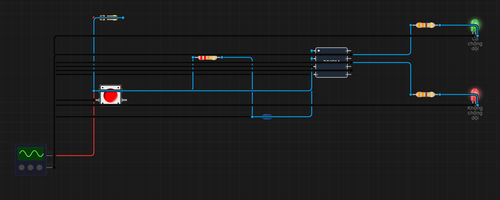
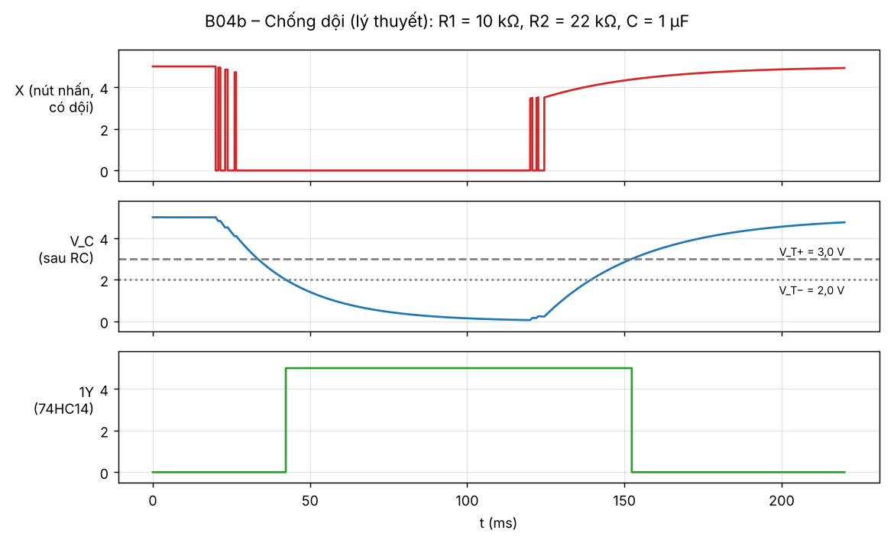

# B04 – Schmitt trigger: tạo xung clock và chống dội nút nhấn

**Sinh viên:** Phạm Anh Quân – MSSV 2353011 · **Môn:** ĐATKLL – HCMUT

**Mức độ:** ★★ · **Nhóm linh kiện:** Nhóm 1 (74HC14) · **Môi trường:** Velxio (mô phỏng SPICE)

| Thành phần | File |
|---|---|
| (a) Bộ dao động RC 1 Hz + 1 kHz (thiết kế cho mạch thật) | `B04a-dao-dong-RC.vlx` |
| (a) Thay thế trong mô phỏng: khối tạo xung 1 kHz qua 74HC14 | `B04a-clock.vlx` |
| (b) Chống dội nút nhấn RC + 74HC14 | `B04b-chong-doi.vlx` |
| Báo cáo PDF | `B04-Schmitt-trigger.pdf` |
| Ảnh minh chứng | `img/` |
| Script | `../tools/gen_b04.py` (sinh 3 file .vlx), `../tools/plot_b04_debounce.py` (giản đồ chống dội) |

---

## 1. Mục tiêu

- (a) Dùng 1 cổng 74HC14 với R, C tạo sóng vuông ≈ 1 Hz (xem bằng LED) và ≈ 1 kHz (xem bằng Oscilloscope), chỉnh được bằng biến trở.
- (b) Chống dội nút nhấn bằng RC + 74HC14: mỗi lần nhấn chỉ có một cạnh xung.
- Giải thích vai trò ngưỡng V_T+ và V_T−.

**Tóm tắt kết quả:** Velxio **không** mô phỏng được bộ dao động RC (lý do ở mục 4.2). Theo đề, phần (a) dùng khối tạo xung có sẵn của Velxio thay cho bộ dao động, còn phần tính RC trình bày ở mục 3. Mạch chống dội (b) chạy đúng logic trong Velxio. Vì Velxio không tạo dội phím, hiện tượng dội được giải thích bằng lý thuyết và giản đồ tính toán.

## 2. Cơ sở lý thuyết: Schmitt trigger và ngưỡng V_T+, V_T−

Cổng đảo thường chỉ có **một** ngưỡng (≈ VCC/2). Khi ngõ vào đổi chậm (sườn RC) hoặc có nhiễu quanh ngưỡng, ngõ ra dao động nhiều lần. Schmitt trigger có **hai ngưỡng**:

- **V_T+ (positive-going threshold):** ngõ vào đang **tăng** phải vượt V_T+ thì ngõ ra mới đổi (74HC14: ra xuống 0).
- **V_T− (negative-going threshold):** ngõ vào đang **giảm** phải xuống dưới V_T− thì ngõ ra mới đổi lại (lên 1).
- **Độ trễ (hysteresis):** V_H = V_T+ − V_T−. Nhiễu có biên độ nhỏ hơn V_H không làm ngõ ra đổi trạng thái.

```
 Vout
  5V ─────────────┐◄──────┐
                  │       │        ngõ vào tăng: đổi tại V_T+
                  │       │        ngõ vào giảm: đổi tại V_T−
  0V              └──────►└──────
                 V_T−    V_T+      Vin
```

| Nguồn ngưỡng | V_T+ | V_T− | V_H |
|---|---|---|---|
| Mô hình 74HC14 trong Velxio (mã nguồn `componentToSpice.ts`) | 0,6·VCC = 3,0 V | 0,4·VCC = 2,0 V | 1,0 V |
| Datasheet 74HC14 (NXP/Nexperia), VCC = 4,5 V, giá trị điển hình* | ≈ 2,4 V | ≈ 1,4 V | ≈ 1,0 V |

\* Cần đối chiếu lại bảng *Transfer characteristics* trong datasheet khi lắp mạch thật; ngưỡng thực tế trải rộng giữa min và max, nên tần số thật lệch so với tính toán.

## 3. (a) Bộ dao động RC với 74HC14

### 3.1. Nguyên lý

R nối từ ngõ ra về ngõ vào, C từ ngõ vào xuống GND.

1. Ra = 1 (5 V): C nạp qua R. Khi V_C tăng tới V_T+, ngõ ra lật về 0.
2. Ra = 0: C xả qua R. Khi V_C giảm tới V_T−, ngõ ra lật lên 1. Lặp lại.

V_C dao động giữa V_T− và V_T+, ngõ ra là sóng vuông.

### 3.2. Công thức tần số

Thời gian nạp từ V_T− lên V_T+ và xả từ V_T+ xuống V_T−:

- t_H = R·C·ln[(VCC − V_T−)/(VCC − V_T+)]
- t_L = R·C·ln(V_T+/V_T−)
- f = 1 / (t_H + t_L) = 1 / (k·R·C)

| Ngưỡng | k = ln[(VCC−V_T−)/(VCC−V_T+)] + ln(V_T+/V_T−) | Công thức |
|---|---|---|
| Velxio (3,0 / 2,0 V, VCC = 5 V) | ln(3/2) + ln(3/2) = 0,811 | f ≈ 1 / (0,81·R·C) |
| Datasheet điển hình (2,4 / 1,4 V, VCC = 5 V) | ln(3,6/2,6) + ln(2,4/1,4) = 0,864 | f ≈ 1 / (0,86·R·C) |

Kết quả khớp công thức gợi ý của đề, f ≈ 1/(0,8·R·C). Với ngưỡng đối xứng quanh VCC/2 (Velxio), t_H = t_L nên chu kỳ nhiệm vụ 50%.

### 3.3. Chọn linh kiện (tính với k = 0,81)

| Phiên bản | C | R cần | R thực tế | Dải chỉnh | Tần số |
|---|---|---|---|---|---|
| 1 Hz (LED) | 10 µF | 1/(0,81·1·10⁻⁵) = 123 kΩ | 100 kΩ + biến trở 50 kΩ | 100 – 150 kΩ | 1,23 Hz – 0,82 Hz (giữa: 125 kΩ → 0,99 Hz) |
| 1 kHz (scope) | 100 nF | 1/(0,81·10³·10⁻⁷) = 12,3 kΩ | 10 kΩ + biến trở 5 kΩ | 10 – 15 kΩ | 1,23 kHz – 0,82 kHz (giữa: 12,5 kΩ → 0,99 kHz) |

Dải chỉnh ±23% quanh giá trị danh định, đủ bù sai lệch ngưỡng giữa các IC (yêu cầu sai lệch < 30%). Điện trở cố định nối tiếp biến trở để R không bao giờ về 0, tránh ngắn mạch ngõ ra với tụ. Trên mạch thật nên chọn R ≥ 10 kΩ để dòng nạp/xả nhỏ so với khả năng ngõ ra.

Project `B04a-dao-dong-RC.vlx` dựng đúng hai mạch này trên cổng 1 và 2 của 74HC14, biến trở mắc kiểu rheostat (chân GND nối chung con trượt), LED đỏ (1 Hz) và xanh lá (1 kHz) ở ngõ ra. Các ngõ vào 3A–6A không dùng nối GND.

### 3.4. Thử trong Velxio: không dao động

| Thử nghiệm | Kết quả |
|---|---|
| Mở `B04a-dao-dong-RC.vlx`, không mở scope | Velxio chạy phân tích DC `.op`, ra một điểm làm việc giả (hai nút ngõ vào ≈ 1,8 V và 2,3 V, cả hai ngõ ra 5 V, trái với định luật Kirchhoff vì tụ hở mạch ở DC). Hai LED sáng đứng yên. |
| Mở Oscilloscope, đo 2A và 2Y (scope buộc Velxio chạy `.tran` 20 ms) | Cả hai kênh là đường thẳng, không có dao động (ảnh dưới). |
| Thử riêng mạch tối giản (1 cổng, R 12 kΩ, C 100 nF) | ngspice báo `Dynamic gmin stepping failed` (`.op`) và `Transient op failed, timestep too small` (`.tran`). |



**Nguyên nhân** (đọc từ mã nguồn Velxio):

1. Velxio chỉ chạy mô phỏng quá độ (`.tran`) khi có Signal Generator dạng AC, hoặc tụ nối với chân vi điều khiển đang xuất tín hiệu. Mạch chỉ có nguồn DC + R + C nên Velxio chỉ giải `.op`, không có trục thời gian.
2. Ở chế độ DC, tụ hở mạch nên V_1A = V_1Y. Mô hình Schmitt `V(Y) = 5·(1 − u(V(A) − ngưỡng(V(Y))))` khi đó **vô nghiệm**: Y = 5 V đòi Y = 0 V và ngược lại. Mạch dao động không có điểm cân bằng DC. ngspice hoặc báo lỗi, hoặc dừng ở một nghiệm giả.
3. Ngay cả khi có `.tran`, Velxio luôn chạy lại từ t = 0 và chỉ dài tối đa 0,4 s, không chạy liên tục. Vì vậy LED 1 Hz không thể nhấp nháy theo thời gian thực.

### 3.5. Thay thế trong mô phỏng: khối tạo xung + 74HC14

Theo hướng dẫn của đề, `B04a-clock.vlx` dùng **Signal Generator** dạng vuông 1 kHz, 0–5 V (amplitude 2,5 V, offset 2,5 V) làm nguồn clock, đưa qua 2 tầng 74HC14:

- 1A ← xung từ khối tạo xung → 1Y: clock đảo (LED vàng)
- 2A ← 1Y → 2Y: clock cùng pha, đã được Schmitt sửa sườn (LED xanh lá)

Đo bằng Oscilloscope của Velxio (kênh 1A, 1Y, 2Y), xuất dữ liệu mẫu và đo khoảng cách các sườn lên tại 2,5 V:

| Kênh | Các sườn lên (ms) | Tần số đo |
|---|---|---|
| GEN (1A) | 0; 1; 2; 3; 4 | 1000 Hz |
| 1Y | 0,5; 1,5; 2,5; 3,5; 4,5 | 1000 Hz (lệch pha 180°) |
| CLK (2Y) | 0; 1; 2; 3; 4 | 1000 Hz |



Ảnh màn hình Oscilloscope trong Velxio (bộ vẽ của Velxio nối các mẫu thưa nên sườn trông xiên; dữ liệu mẫu ở hình trên là chính xác):



Ghi chú: Velxio chỉ chạy được 5 ms mỗi lần (4 chu kỳ), và LED ở ngõ ra chỉ hiển thị giá trị mẫu cuối nên không nhấp nháy. Với 1 Hz, hiện tượng tương tự: LED đứng yên. Trên mạch thật hoặc với bộ dao động RC thật, LED 1 Hz sẽ nhấp nháy.

## 4. (b) Mạch chống dội nút nhấn

### 4.1. Hiện tượng dội phím

Tiếp điểm kim loại khi đóng/mở bị nảy vài lần trong khoảng 1–20 ms, tạo ra chuỗi xung 0/1 thay vì một cạnh. Mạch đếm hoặc flip-flop sẽ hiểu thành nhiều lần nhấn.

### 4.2. Mạch

```
 +5V ─ R1 10k ─┬─ X ─ R2 22k ─┬─ C (1A của 74HC14) ──► 1Y: LED xanh "Có chống dội"
               │              │
            nút nhấn       C 1 µF
               │              │
              GND            GND
               X ──────────────────► 2A của 74HC14 ──► 2Y: LED đỏ "Không chống dội"
```

Vai trò từng linh kiện:

| Linh kiện | Vai trò |
|---|---|
| R1 = 10 kΩ (pull-up) | Giữ X = 5 V khi nút hở; giới hạn dòng khi nút đóng (0,5 mA). |
| Nút nhấn | Đóng thì kéo X xuống 0 V. |
| R2 = 22 kΩ, C = 1 µF | Bộ lọc thông thấp: V_C chỉ đổi chậm theo hằng số thời gian, các xung dội ngắn (≪ τ) gần như không làm V_C thay đổi. Nhấn: τ_xả = R2·C = 22 ms. Nhả: τ_nạp = (R1 + R2)·C = 32 ms. |
| 74HC14 | Sườn RC chậm, nếu dùng cổng thường thì ngõ ra dao động khi V_C ở gần ngưỡng. Hysteresis 1 V biến sườn chậm thành **một** cạnh sạch. Cổng đảo nên 1Y = 1 khi đang nhấn. |
| Cổng 2 (X trực tiếp → 2A) | Để so sánh: không có RC, dội phím đi thẳng ra 2Y. |

**Độ trễ phản hồi:** sau lần nảy cuối, V_C xả từ ≈ 5 V xuống V_T− = 2 V mất t = τ·ln(5/2) ≈ 22 × 0,92 ≈ 20 ms. Thời gian này đủ dài để lọc dội 1–20 ms, đủ ngắn để người dùng không thấy trễ.

### 4.3. Kết quả trong Velxio

| Trạng thái | LED xanh (có chống dội, 1Y) | LED đỏ (trực tiếp, 2Y) |
|---|---|---|
| Nút nhả | Tắt | Tắt |
| Nút nhấn | Sáng | Sáng |

| Nút nhả | Nút nhấn |
|---|---|
|  |  |

Velxio giải mạch này bằng `.op` (trạng thái xác lập), và tiếp điểm nút nhấn là lý tưởng (0,01 Ω / 1 GΩ, không nảy). Vì vậy hai LED giống nhau: mô phỏng chỉ xác nhận **logic** đúng, không thể hiện được khác biệt về dội.

### 4.4. Giản đồ lý thuyết

Script `tools/plot_b04_debounce.py` mô phỏng mạch trên theo thời gian với tiếp điểm có dội giả lập (nhấn tại 20 ms, nảy 6 lần tới 26,5 ms; nhả tại 120 ms, nảy 4 lần tới 124,5 ms), ngưỡng theo mô hình Velxio:



Kết quả tính: ngõ ra 1Y chỉ có **đúng một** cạnh lên (42,3 ms) cho lần nhấn và **một** cạnh xuống (152,3 ms) cho lần nhả. Ngõ vào X có tới 7 và 5 lần chuyển mức.

## 5. Khác biệt giữa mô phỏng và mạch thật

1. **Bộ dao động RC** không chạy trong Velxio (mục 3.4). Mạch thật sẽ dao động với tần số theo mục 3.3, sai lệch chủ yếu do V_T+, V_T− khác nhau giữa các IC và dung sai tụ (điện phân thường ±20%).
2. **Dội phím** không được mô phỏng. Trên mạch thật, LED đỏ (2Y) có thể nháy không thấy được bằng mắt nhưng mạch đếm sẽ đếm sai; đo bằng oscilloscope thật sẽ thấy chuỗi xung.
3. **Chân VCC** của 74HC14 không nối dây trong Velxio (B01 mục 5); mạch thật phải nối +5 V và tụ 100 nF sát chân 14.
4. Mạch clock 74HC14 chỉ dùng được trong các bài Nhóm 1. Các bài có Flip-Flop (B08–B10) lấy clock từ công tắc gạt, vì Velxio không cho Signal Generator làm clock Flip-Flop.

## 6. Tài liệu tham khảo

- NXP / Nexperia, *74HC14; 74HCT14 Hex inverting Schmitt trigger*, datasheet (Transfer characteristics, ứng dụng bộ dao động).
- Velxio, mã nguồn `frontend/src/simulation/spice/componentToSpice.ts` (mô hình 74HC14), `storeAdapter.ts` (chọn `.op`/`.tran`), `analogScopeFeed.ts`.
- J. Ganssle, *A Guide to Debouncing* (đo thời gian dội của nút nhấn thực tế).
