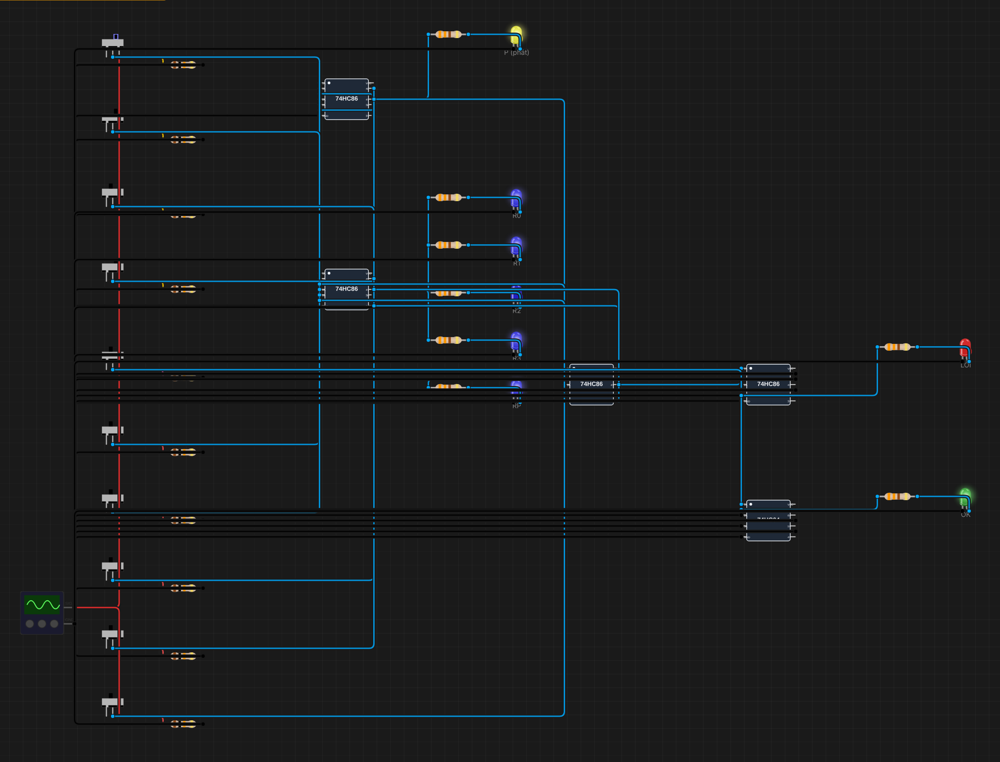
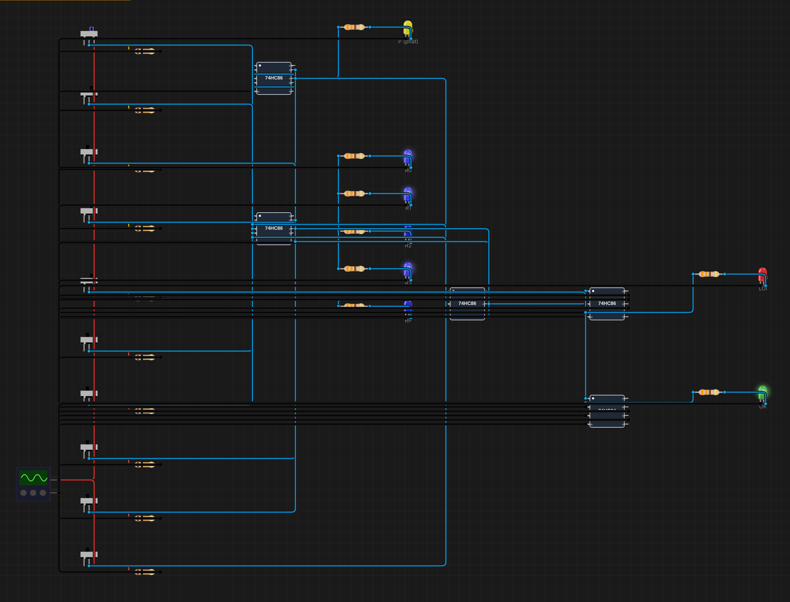
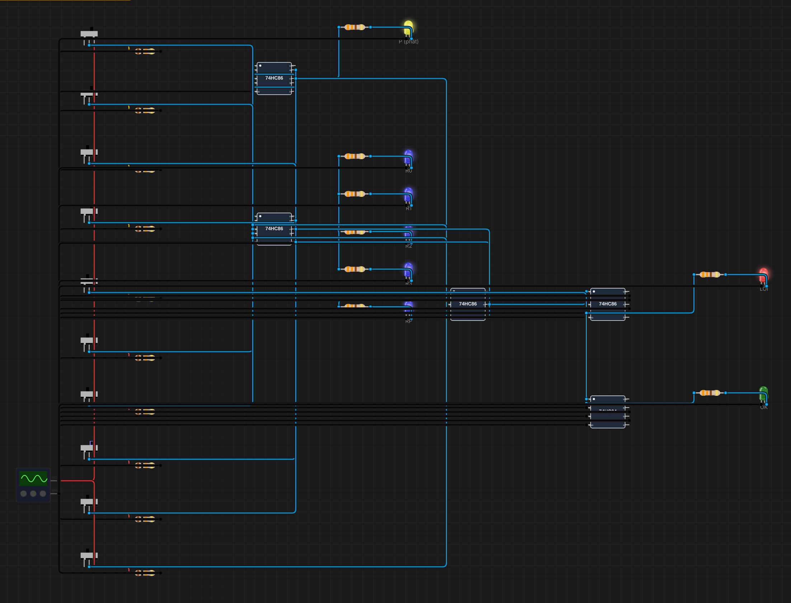
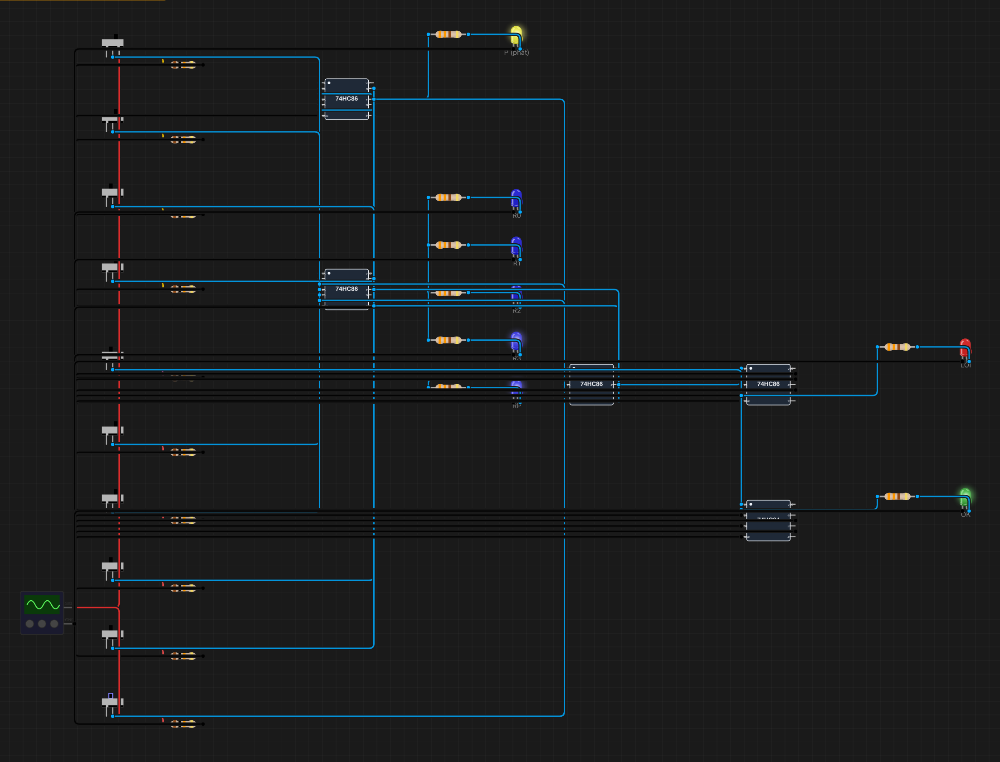

# B05 – Bộ tạo và kiểm tra bit chẵn lẻ 4 bit

**Sinh viên:** Phạm Anh Quân – MSSV 2353011 · **Môn:** ĐATKLL – HCMUT

**Mức độ:** ★★ · **Nhóm linh kiện:** Nhóm 1 (74HC86, 74HC04) · **Môi trường:** Velxio (mô phỏng SPICE)

| Thành phần | File |
|---|---|
| Project mô phỏng | `B05-parity-4bit.vlx` |
| Báo cáo PDF | `B05-parity-4bit.pdf` |
| Ảnh minh chứng | `img/` |
| Script sinh mạch | `../tools/gen_b05.py` |

---

## 1. Mục tiêu

- Tạo bit chẵn lẻ P cho dữ liệu 4 bit D3..D0 (3 cổng XOR).
- Kiểm tra 5 bit nhận được (D3..D0, P) và báo lỗi khi tổng số bit 1 sai quy ước (4 cổng XOR).
- Chuyển giữa even parity và odd parity chỉ bằng **một** công tắc.
- Lật bit để giả lập lỗi truyền; chứng minh lỗi 2 bit không bị phát hiện.

## 2. Cơ sở lý thuyết

XOR nhiều ngõ vào cho 1 khi **số ngõ vào bằng 1 là lẻ**: D0 ⊕ D1 ⊕ D2 ⊕ D3 = 1 ⇔ có lẻ bit 1.

- **Even parity:** chọn P sao cho tổng số bit 1 của (D3..D0, P) là **chẵn** ⇒ P = D0 ⊕ D1 ⊕ D2 ⊕ D3.
- **Odd parity:** tổng số bit 1 là **lẻ** ⇒ P = ¬(D0 ⊕ D1 ⊕ D2 ⊕ D3).

Vì X ⊕ 0 = X và X ⊕ 1 = ¬X, cổng XOR là **cổng đảo có điều khiển**. Một công tắc M (0 = even, 1 = odd) qua thêm một XOR là đủ để chuyển chế độ: P = D0 ⊕ D1 ⊕ D2 ⊕ D3 ⊕ M.

**Bên thu:** X = R0 ⊕ R1 ⊕ R2 ⊕ R3 ⊕ RP. Không lỗi thì X = M (X = 0 ở even, X = 1 ở odd). Do đó cờ lỗi ERR = X ⊕ M.

**Cấu trúc cây.** ((D0 ⊕ D1) ⊕ (D2 ⊕ D3)) có độ sâu 2 cổng, thay vì 3 cổng nếu nối chuỗi (((D0 ⊕ D1) ⊕ D2) ⊕ D3), nên trễ lan truyền nhỏ hơn.

## 3. Thiết kế

### 3.1. Sơ đồ khối

```
 D3..D0 ─┬──────────────► [Bộ tạo: 3 XOR cây] ─► S ─► XOR(M) ─► P ─────┐
         │                                                             │
         └─► [Kênh: Di ⊕ Ei] ─► R3..R0 ─┐            P ⊕ E4 ─► RP ◄────┘
                                         ▼                     │
                         [Bộ kiểm tra: 4 XOR cây] ◄────────────┘
                                         │ X
                                    XOR(M) ─► ERR (LED đỏ) ─► NOT ─► OK (LED xanh)
```

### 3.2. Phân bổ cổng

| IC | Cổng | Chức năng |
|---|---|---|
| u1 74HC86 | 1, 2, 3 | **Bộ tạo:** D0⊕D1, D2⊕D3, S = (D0⊕D1)⊕(D2⊕D3) – **3 XOR** |
| | 4 | P = S ⊕ M (chọn even/odd) |
| u2 74HC86 | 1–4 | Kênh: Ri = Di ⊕ Ei (Ei = 1 ⇒ bit i bị lật) |
| u3 74HC86 | 1 | Kênh: RP = P ⊕ E4 |
| | 2, 3, 4 | **Bộ kiểm tra:** R0⊕R1, R2⊕R3, (R0⊕R1)⊕(R2⊕R3) |
| u4 74HC86 | 1 | **Bộ kiểm tra:** X = (R0..R3) ⊕ RP – tổng cộng **4 XOR** |
| | 2 | ERR = X ⊕ M |
| | 3, 4 | không dùng (ngõ vào nối GND) |
| u5 74HC04 | 1 | OK = ¬ERR (cổng 2–6 không dùng, ngõ vào nối GND) |

Bộ tạo dùng đúng 3 XOR, bộ kiểm tra đúng 4 XOR như đề yêu cầu. Thêm 2 XOR cho chế độ even/odd (một ở bên phát, một ở bên thu, cùng do công tắc M điều khiển) và 5 XOR cho kênh lỗi giả lập. Phần kênh lỗi không thuộc bộ tạo/kiểm tra, chỉ để thí nghiệm.

### 3.3. Bố trí trên canvas

- **Công tắc** (cột trái, từ trên xuống): D0, D1, D2, D3, M, E0, E1, E2, E3, E4. Mỗi công tắc có pull-down 10 kΩ, gạt sang phải = 1.
- **LED:** P (vàng); R0, R1, R2, R3, RP (xanh dương, các bit bên thu nhận được); LỖI (đỏ); OK (xanh lá).

Thống kê: 5 IC, 10 công tắc, 18 điện trở, 8 LED; 42 linh kiện, 97 dây.

## 4. Kết quả mô phỏng

Toàn bộ 46 trường hợp dưới đây được chạy trong Velxio bằng cách gạt công tắc và đọc trạng thái LED. Cả 46 trường hợp đều khớp giá trị tính lý thuyết.

### 4.1. Bộ tạo: 16 tổ hợp × 2 chế độ (không lỗi)

| D3 D2 D1 D0 | Số bit 1 | P (even, M=0) | P (odd, M=1) | LỖI | OK |
|---|---|---|---|---|---|
| 0000 | 0 | 0 | 1 | 0 | 1 |
| 0001 | 1 | 1 | 0 | 0 | 1 |
| 0010 | 1 | 1 | 0 | 0 | 1 |
| 0011 | 2 | 0 | 1 | 0 | 1 |
| 0100 | 1 | 1 | 0 | 0 | 1 |
| 0101 | 2 | 0 | 1 | 0 | 1 |
| 0110 | 2 | 0 | 1 | 0 | 1 |
| 0111 | 3 | 1 | 0 | 0 | 1 |
| 1000 | 1 | 1 | 0 | 0 | 1 |
| 1001 | 2 | 0 | 1 | 0 | 1 |
| 1010 | 2 | 0 | 1 | 0 | 1 |
| 1011 | 3 | 1 | 0 | 0 | 1 |
| 1100 | 2 | 0 | 1 | 0 | 1 |
| 1101 | 3 | 1 | 0 | 0 | 1 |
| 1110 | 3 | 1 | 0 | 0 | 1 |
| 1111 | 4 | 0 | 1 | 0 | 1 |

P ở hai chế độ luôn ngược nhau, và khi không có lỗi thì LED LỖI luôn tắt ở cả hai chế độ. **Một công tắc M đổi được chế độ cho cả bên phát lẫn bên thu.**

### 4.2. Lỗi 1 bit: luôn bị phát hiện

Dữ liệu D = 1011:

| Bit bị lật | Even (M=0): R3..R0, RP | LỖI | Odd (M=1): R3..R0, RP | LỖI |
|---|---|---|---|---|
| D0 (E0) | 1010, 1 | **1** | 1010, 0 | **1** |
| D1 (E1) | 1001, 1 | **1** | 1001, 0 | **1** |
| D2 (E2) | 1111, 1 | **1** | 1111, 0 | **1** |
| D3 (E3) | 0011, 1 | **1** | 0011, 0 | **1** |
| P (E4) | 1011, 0 | **1** | 1011, 1 | **1** |

### 4.3. Lỗi 2 bit: không phát hiện được

| Bit bị lật | Chế độ | R3..R0, RP | LỖI | OK |
|---|---|---|---|---|
| D0 + D1 | even | 1000, 1 | 0 | 1 |
| D2 + P | even | 1111, 0 | 0 | 1 |
| D0 + D1 | odd | 1000, 0 | 0 | 1 |
| D2 + P | odd | 1111, 1 | 0 | 1 |

Dữ liệu nhận (1000 hoặc 1111) đã sai nhưng LED OK vẫn sáng. **Giải thích:** mỗi lần lật một bit đổi tính chẵn/lẻ của tổng số bit 1. Lật 2 bit thì đổi 2 lần, tính chẵn/lẻ trở về như cũ, nên X không đổi. Tổng quát, parity phát hiện được mọi lỗi **lẻ** bit và bỏ sót mọi lỗi **chẵn** bit. Muốn phát hiện hoặc sửa lỗi nhiều bit cần mã mạnh hơn (Hamming, CRC).

### 4.4. Ảnh chụp

| Even, D=1011, không lỗi (P=1, OK sáng) | Odd, D=1011, không lỗi (P=0, OK sáng) |
|---|---|
|  |  |
| **Even, lật D2 (LỖI sáng)** | **Even, lật D0 + D1 (lỗi 2 bit, OK vẫn sáng)** |
|  |  |

## 5. Khác biệt giữa mô phỏng và mạch thật

1. Velxio không có độ trễ cổng. Trên mạch thật, đường dài nhất từ D đến LỖI đi qua u1 (2 tầng) → u1.4 → u3.1 → u4.1 → u4.2, tức 6 tầng XOR × t_pd. Trong lúc D đổi, LED LỖI có thể chớp một xung rất ngắn (glitch) trước khi ổn định.
2. Chân VCC của IC không nối dây trong Velxio (B01 mục 5). Mạch thật phải cấp +5 V và tụ 100 nF cho từng IC.

## 6. Tài liệu tham khảo

- M. Morris Mano, *Digital Design*, mục "Parity generation and checking".
- Nexperia, *74HC86 Quad 2-input EXCLUSIVE-OR gate*, datasheet.
