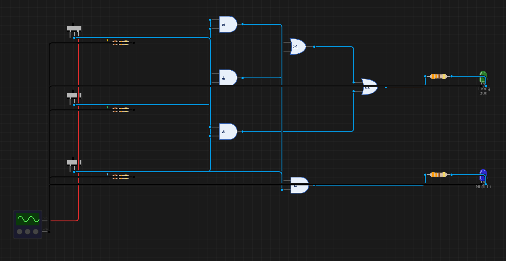
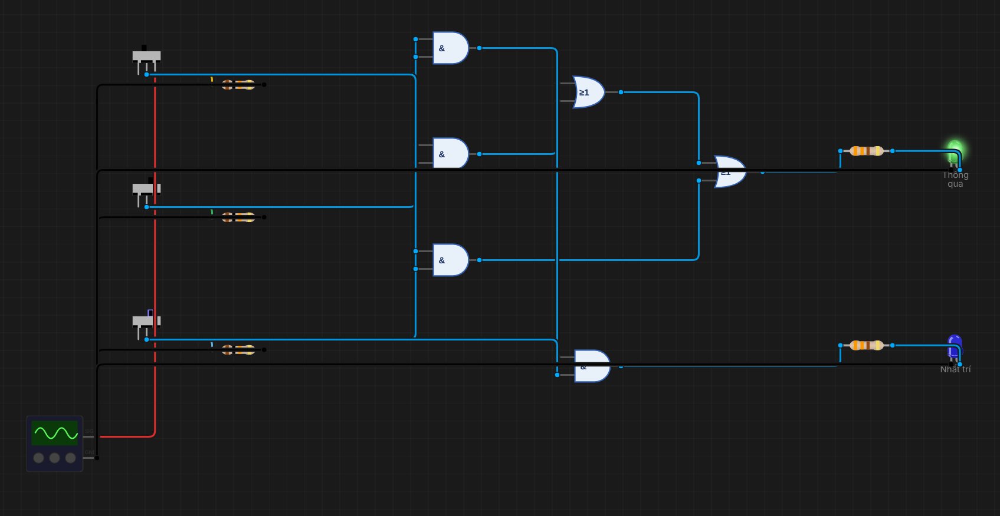
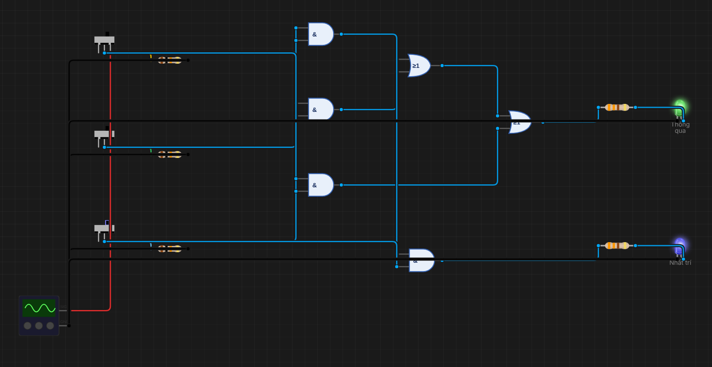

# B06 – Mạch biểu quyết đa số 3 người

**Sinh viên:** Phạm Anh Quân – MSSV 2353011 · **Môn:** ĐATKLL – HCMUT

**Mức độ:** ★★ · **Nhóm linh kiện:** Nhóm 2 (cổng AND, OR rời) · **Môi trường:** Velxio (bộ mô phỏng số – digital gate engine)

| Thành phần | File |
|---|---|
| Project mô phỏng | `B06-bieu-quyet-da-so.vlx` |
| Báo cáo PDF | `B06-bieu-quyet-da-so.pdf` |
| Ảnh minh chứng | `img/B06_ABC.png` |
| Script sinh mạch | `../tools/gen_b06.py` |

---

## 1. Mục tiêu

- Ba thành viên A, B, C gạt công tắc (1 = tán thành). Đèn **Thông qua** sáng khi có ít nhất 2 người tán thành.
- Mở rộng: đèn **Nhất trí** sáng khi cả 3 cùng tán thành.
- Lập bảng chân trị, rút gọn bằng bìa Karnaugh, trình bày dạng SOP và POS; mạch Thông qua dùng tối đa 5 cổng 2 ngõ vào.

## 2. Bảng chân trị

| m | A | B | C | Số phiếu | Y (Thông qua) | U (Nhất trí) |
|---|---|---|---|---|---|---|
| 0 | 0 | 0 | 0 | 0 | 0 | 0 |
| 1 | 0 | 0 | 1 | 1 | 0 | 0 |
| 2 | 0 | 1 | 0 | 1 | 0 | 0 |
| 3 | 0 | 1 | 1 | 2 | 1 | 0 |
| 4 | 1 | 0 | 0 | 1 | 0 | 0 |
| 5 | 1 | 0 | 1 | 2 | 1 | 0 |
| 6 | 1 | 1 | 0 | 2 | 1 | 0 |
| 7 | 1 | 1 | 1 | 3 | 1 | 1 |

Dạng chính tắc: **Y = Σm(3, 5, 6, 7) = ΠM(0, 1, 2, 4)**; U = m7 = A·B·C.

## 3. Rút gọn bằng bìa Karnaugh

Hàng là A, cột là BC theo mã Gray (00, 01, 11, 10):

| A \ BC | 00 | 01 | 11 | 10 |
|---|---|---|---|---|
| **0** | 0 | 0 | **1** (m3) | 0 |
| **1** | 0 | **1** (m5) | **1** (m7) | **1** (m6) |

### 3.1. Dạng tổng các tích (SOP) – nhóm các ô 1

Ba nhóm đôi, đều chứa m7:

- {m3, m7} (cột BC = 11): **B·C**
- {m5, m7} (hàng A = 1, cột 01–11): **A·C**
- {m6, m7} (hàng A = 1, cột 11–10): **A·B**

⇒ **Y = AB + BC + AC**

### 3.2. Dạng tích các tổng (POS) – nhóm các ô 0

Nhóm các ô 0 cho Y': {m0, m1} = A'B', {m0, m2} = A'C', {m0, m4} = B'C'.
⇒ Y' = A'B' + A'C' + B'C' ⇒ (De Morgan) **Y = (A + B)(A + C)(B + C)**

Kiểm tra: khai triển (A + B)(A + C) = A + BC, nhân với (B + C) được AB + AC + BC + BC = AB + BC + AC, trùng dạng SOP.

### 3.3. Số cổng

| Dạng | Cổng 2 ngõ vào |
|---|---|
| SOP: 3 AND (AB, BC, AC) + 2 OR | **5** |
| POS: 3 OR + 2 AND | 5 |
| Nhất trí U = (AB)·C | +1 AND (dùng lại tích AB của mạch SOP) |

Đề gợi ý "thêm 2 cổng AND" cho đèn Nhất trí, ứng với cách dựng độc lập A·B·C bằng 2 cổng. Ở đây tích AB đã có sẵn trong mạch Thông qua, nên chỉ cần 1 cổng AND nữa. Tổng cộng 6 cổng.

## 4. Thiết kế mạch mô phỏng

```
A ─┬────────┐
   │       AND(g_ab) ──── AB ──┬──► OR(g_or1) ──┐
B ─┼──┬─────┘                  │                ├─► OR(g_or2) ─► Y ─► LED "Thông qua" (xanh lá)
   │  └──── AND(g_bc) ── BC ───┘                │
C ─┼──┬──── AND(g_ac) ── AC ────────────────────┘
   └──┼─────┘
      └───────────────── AND(g_abc) ◄── AB ──► U ─► LED "Nhất trí" (xanh dương)
```

- Nguồn: Signal Generator DC 5 V. Công tắc A, B, C (từ trên xuống) có pull-down 10 kΩ.
- Cổng: linh kiện `logic-gate-and` / `logic-gate-or` rời của Velxio (Nhóm 2, không dùng IC 74HC).
- Ngõ ra: Y → 330 Ω → LED → GND.

Thống kê: 6 cổng, 3 công tắc, 5 điện trở, 2 LED; 17 linh kiện, 27 dây.

Mạch chỉ gồm cổng, công tắc, điện trở, LED và nguồn DC, nên Velxio dùng **digital gate engine** (bộ mô phỏng sự kiện số) thay vì SPICE. Kết quả là mức logic chính xác và cập nhật tức thì khi gạt công tắc.

## 5. Kết quả mô phỏng

Gạt đủ 8 tổ hợp, đọc trạng thái 2 LED:

| A | B | C | Thông qua | Nhất trí | Đúng lý thuyết? |
|---|---|---|---|---|---|
| 0 | 0 | 0 | 0 | 0 | ✓ |
| 0 | 0 | 1 | 0 | 0 | ✓ |
| 0 | 1 | 0 | 0 | 0 | ✓ |
| 0 | 1 | 1 | 1 | 0 | ✓ |
| 1 | 0 | 0 | 0 | 0 | ✓ |
| 1 | 0 | 1 | 1 | 0 | ✓ |
| 1 | 1 | 0 | 1 | 0 | ✓ |
| 1 | 1 | 1 | 1 | 1 | ✓ |

| A=0, B=0, C=0 | A=0, B=1, C=1 |
|---|---|
|  |  |
| **A=1, B=0, C=1** | **A=1, B=1, C=1** |
|  |  |

## 6. Nhận xét

- Hàm đa số là hàm **đối xứng**: hoán đổi A, B, C không làm thay đổi kết quả. Vì vậy SOP và POS có cùng cấu trúc (3 + 2 cổng).
- Hàm đa số còn là hàm **tự đối ngẫu**: đổi AND ↔ OR trong AB + BC + AC được (A + B)(B + C)(A + C), vẫn là chính nó (mục 3.2). Trong bộ cộng toàn phần, C_out = AB + C_in(A ⊕ B) cũng chính là hàm đa số của (A, B, C_in). Mạch này sẽ gặp lại ở C01.
- Mạch thật: cổng Velxio không có trễ. Trong mạch SOP đủ 3 số hạng, mọi cặp ô 1 kề nhau trên bìa K đều nằm chung một nhóm, nên khi **chỉ một** công tắc đổi thì Y không có hazard tĩnh. Khi **hai** công tắc đổi gần như cùng lúc (ví dụ 011 → 101: BC tắt, AC bật), trên mạch thật Y có thể tụt về 0 một xung rất ngắn (glitch) nếu BC tắt trước khi AC kịp bật.

## 7. Tài liệu tham khảo

- M. Morris Mano, *Digital Design*, chương 3 (bìa Karnaugh, dạng chính tắc SOP/POS).
- Velxio, mã nguồn `frontend/src/simulation/digital/digitalGateEngine.ts`.
