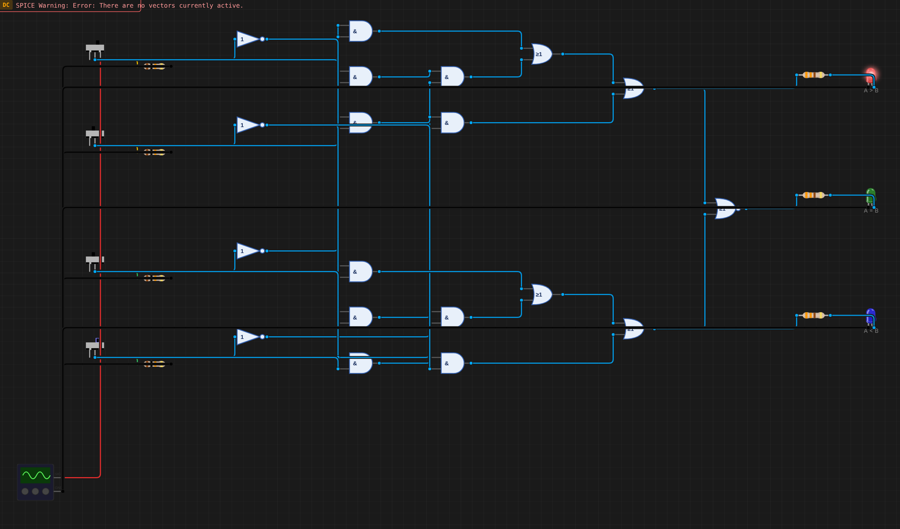
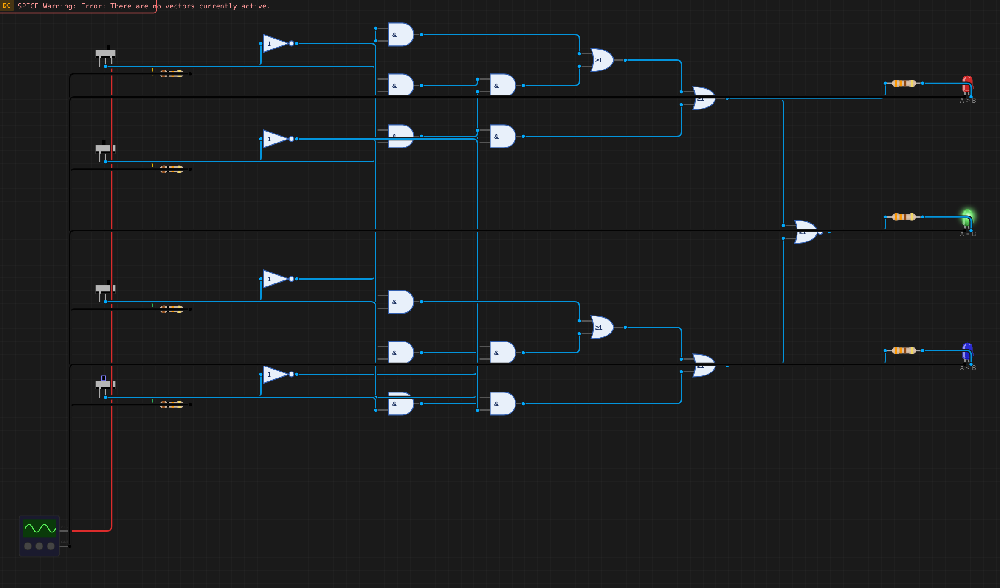
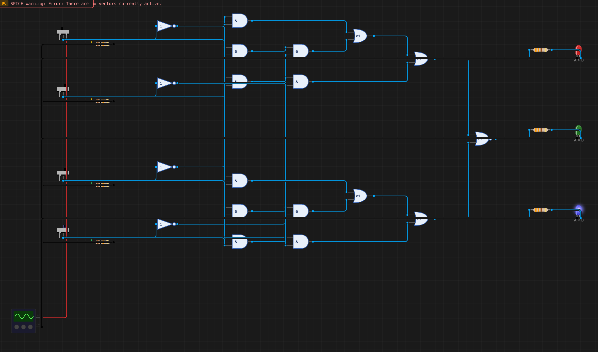

# B07 – Bộ so sánh độ lớn 2 bit

**Sinh viên:** Phạm Anh Quân – MSSV 2353011 · **Môn:** ĐATKLL – HCMUT

**Mức độ:** ★★★ · **Nhóm linh kiện:** Nhóm 2 (cổng AND, OR, NOT, NOR rời) · **Môi trường:** Velxio (digital gate engine)

| Thành phần | File |
|---|---|
| Project mô phỏng | `B07-so-sanh-2bit.vlx` |
| Báo cáo PDF | `B07-so-sanh-2bit.pdf` |
| Ảnh minh chứng | `img/` |
| Script sinh mạch | `../tools/gen_b07.py` |

---

## 1. Mục tiêu

So sánh A = A1A0 với B = B1B0. Ba LED báo A > B, A = B, A < B, và tại mọi thời điểm chỉ một LED sáng. Ngõ ra A = B tạo từ hai ngõ ra còn lại bằng **1 cổng NOR**. Kiểm tra đủ 16 tổ hợp.

## 2. Bảng chân trị (16 dòng)

| A1 A0 | B1 B0 | A | B | G (A>B) | E (A=B) | L (A<B) |
|---|---|---|---|---|---|---|
| 00 | 00 | 0 | 0 | 0 | 1 | 0 |
| 00 | 01 | 0 | 1 | 0 | 0 | 1 |
| 00 | 10 | 0 | 2 | 0 | 0 | 1 |
| 00 | 11 | 0 | 3 | 0 | 0 | 1 |
| 01 | 00 | 1 | 0 | 1 | 0 | 0 |
| 01 | 01 | 1 | 1 | 0 | 1 | 0 |
| 01 | 10 | 1 | 2 | 0 | 0 | 1 |
| 01 | 11 | 1 | 3 | 0 | 0 | 1 |
| 10 | 00 | 2 | 0 | 1 | 0 | 0 |
| 10 | 01 | 2 | 1 | 1 | 0 | 0 |
| 10 | 10 | 2 | 2 | 0 | 1 | 0 |
| 10 | 11 | 2 | 3 | 0 | 0 | 1 |
| 11 | 00 | 3 | 0 | 1 | 0 | 0 |
| 11 | 01 | 3 | 1 | 1 | 0 | 0 |
| 11 | 10 | 3 | 2 | 1 | 0 | 0 |
| 11 | 11 | 3 | 3 | 0 | 1 | 0 |

## 3. Bìa Karnaugh và biểu thức rút gọn

Hàng: A1A0, cột: B1B0, cả hai theo mã Gray 00, 01, 11, 10.

### 3.1. G (A > B)

| A1A0 \ B1B0 | 00 | 01 | 11 | 10 |
|---|---|---|---|---|
| **00** | 0 | 0 | 0 | 0 |
| **01** | 1 | 0 | 0 | 0 |
| **11** | 1 | 1 | 0 | 1 |
| **10** | 1 | 1 | 0 | 0 |

Nhóm:

- Nhóm 4 ô (hàng 11, 10 × cột 00, 01): **A1·B1'**
- Nhóm 2 ô (hàng 11, cột 00 và 10, kề nhau qua mép bìa): **A1·A0·B0'**
- Nhóm 2 ô (hàng 01, 11 × cột 00): **A0·B1'·B0'**

⇒ **G = A1·B1' + A1·A0·B0' + A0·B1'·B0'**

### 3.2. L (A < B)

| A1A0 \ B1B0 | 00 | 01 | 11 | 10 |
|---|---|---|---|---|
| **00** | 0 | 1 | 1 | 1 |
| **01** | 0 | 0 | 1 | 1 |
| **11** | 0 | 0 | 0 | 0 |
| **10** | 0 | 0 | 1 | 0 |

Hàm L đối xứng với G khi đổi vai A và B:

- Nhóm 4 ô (hàng 00, 01 × cột 11, 10): **A1'·B1**
- Nhóm 2 ô (hàng 00, cột 01, 11): **A1'·A0'·B0**
- Nhóm 2 ô (hàng 00, 10 × cột 11): **A0'·B1·B0**

⇒ **L = A1'·B1 + A1'·A0'·B0 + A0'·B1·B0**

### 3.3. E (A = B)

| A1A0 \ B1B0 | 00 | 01 | 11 | 10 |
|---|---|---|---|---|
| **00** | 1 | 0 | 0 | 0 |
| **01** | 0 | 1 | 0 | 0 |
| **11** | 0 | 0 | 1 | 0 |
| **10** | 0 | 0 | 0 | 1 |

Bốn ô 1 nằm trên đường chéo, không ô nào kề nhau nên không gộp được. Dạng SOP trực tiếp cần 4 tích 4 biến:
E = A1'A0'B1'B0' + A1'A0B1'B0 + A1A0B1B0 + A1A0'B1B0' = (A1 ⊙ B1)·(A0 ⊙ B0).

Dựng XNOR từ AND/OR/NOT tốn nhiều cổng. Vì G, E, L loại trừ nhau và luôn có đúng một bằng 1 (G + E + L = 1):

⇒ **E = ¬(G + L) = NOR(G, L)**: chỉ **1 cổng NOR**.

## 4. Thiết kế mạch

Mọi cổng là cổng 2 ngõ vào; tích 3 biến dựng bằng 2 cổng AND nối tầng.

| Khối | Cổng | Số cổng |
|---|---|---|
| Đảo | A1', A0', B1', B0' | 4 NOT |
| G | A1·B1'; (A1·A0)·B0'; (A0·B1')·B0'; 2 OR gộp | 5 AND + 2 OR |
| L | A1'·B1; (A1'·A0')·B0; (B1·B0)·A0'; 2 OR gộp | 5 AND + 2 OR |
| E | NOR(G, L) | 1 NOR |
| **Tổng** | | **19 cổng** |

- Công tắc (từ trên xuống): A1, A0 (vàng), B1, B0 (xanh lá); pull-down 10 kΩ.
- LED: A > B đỏ, A = B xanh lá, A < B xanh dương.
- Thống kê: 19 cổng, 4 công tắc, 7 điện trở, 3 LED; 34 linh kiện, 55 dây.

So sánh "bit cao trước" như gợi ý của đề: số hạng A1·B1' xử lý trường hợp bit cao quyết định. Hai số hạng 3 biến xử lý trường hợp A1 = B1 và bit thấp quyết định, đã được bìa K rút gọn sẵn nên không cần XNOR.

## 5. Kết quả mô phỏng

Gạt đủ 16 tổ hợp, đọc 3 LED. **16/16 khớp bảng chân trị**, và mọi tổ hợp đều có đúng 1 LED sáng.

| A \ B | 0 | 1 | 2 | 3 |
|---|---|---|---|---|
| **0** | = | < | < | < |
| **1** | > | = | < | < |
| **2** | > | > | = | < |
| **3** | > | > | > | = |

| A = 2, B = 1 (A > B) | A = 2, B = 2 (A = B) | A = 1, B = 3 (A < B) |
|---|---|---|
|  |  |  |

Ghi chú: dòng chữ đỏ "SPICE Warning: There are no vectors currently active" ở góc ảnh là thông báo của bộ giải SPICE. Mạch toàn cổng số được Velxio chạy bằng digital gate engine, nên SPICE không có gì để giải. Thông báo này không ảnh hưởng kết quả.

## 6. Mở rộng

- **Ghép tầng (cascading):** IC 74HC85 so sánh 4 bit có thêm ngõ vào I(A>B), I(A=B), I(A<B) từ tầng thấp hơn. Mở rộng mạch này: tầng cao chỉ dùng kết quả tầng thấp khi các bit cao bằng nhau, ví dụ G = G_cao + E_cao·G_thấp.
- **Mạch thật:** đường dài nhất là NOT → AND → AND → OR → OR → NOR (6 tầng). Khi chuyển trạng thái, LED A = B có thể chớp sai một xung rất ngắn vì G và L không đổi cùng lúc.

## 7. Tài liệu tham khảo

- M. Morris Mano, *Digital Design*, mục "Magnitude comparator".
- Texas Instruments, *SN74HC85 4-bit magnitude comparator*, datasheet.

## Video demo

[Video demo local](video/B07-demo.mp4) — 58,53 s, H.264, 1880×944. Quay Velxio thật đủ 16 cặp A/B hai bit, theo thứ tự Gray của A1 A0 B1 B0. Mỗi cảnh có đúng một LED A > B, A = B hoặc A < B sáng, khớp kết quả so sánh. Con trỏ di chuyển mượt, gần thẳng và rung nhẹ; seed 6007.
