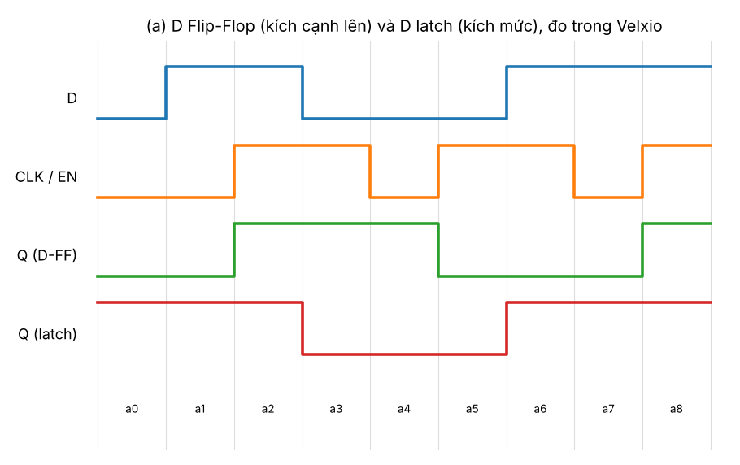
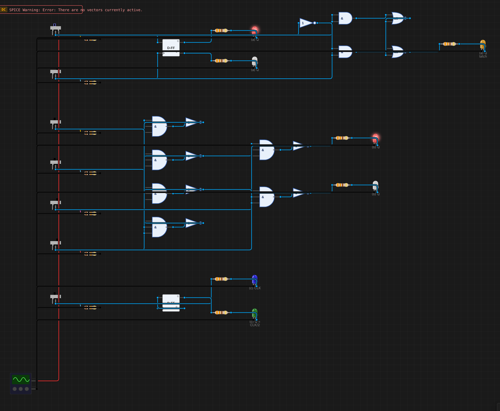
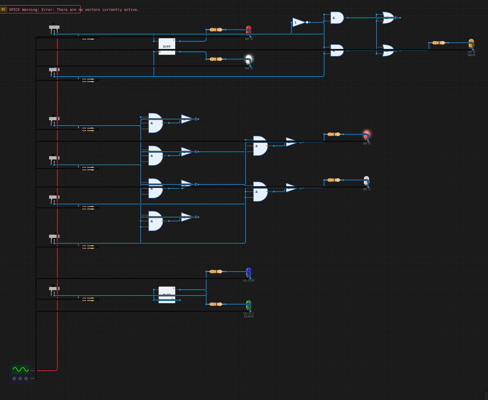
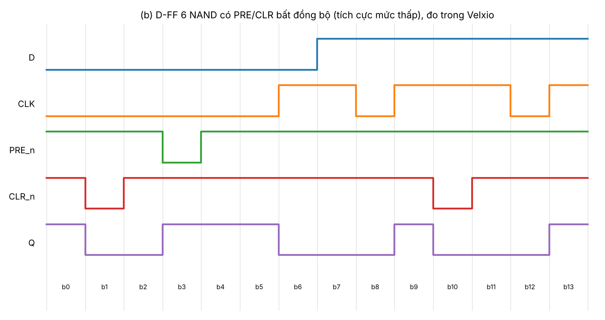
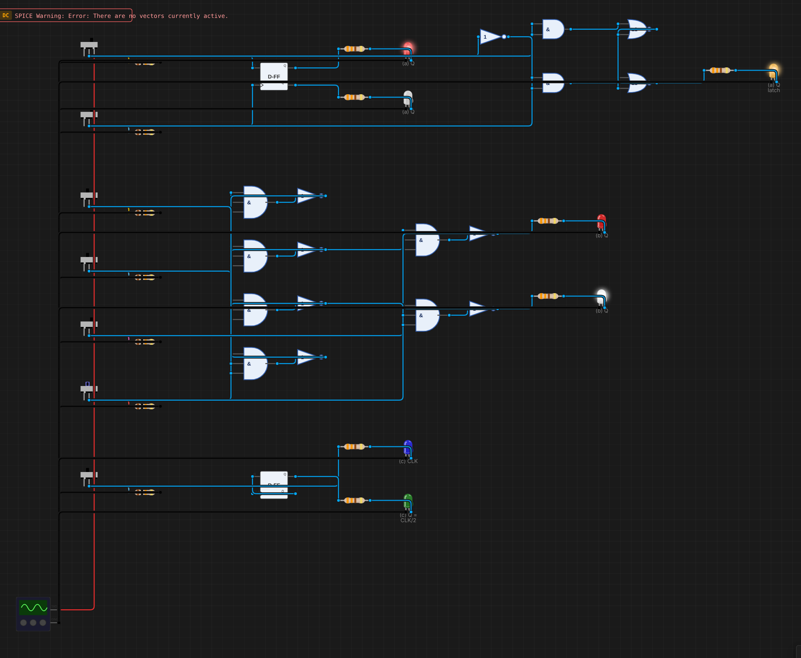
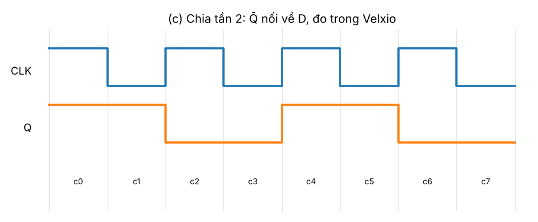

# B08 – Khảo sát D Flip-Flop: chốt dữ liệu và chia tần

**Sinh viên:** Phạm Anh Quân – MSSV 2353011 · **Môn:** ĐATKLL – HCMUT

**Mức độ:** ★★ · **Nhóm linh kiện:** Nhóm 2 (D Flip-Flop, cổng AND, NOT, NOR) · **Môi trường:** Velxio (digital gate engine)

| Thành phần | File |
|---|---|
| Project mô phỏng (cả 3 thí nghiệm trong một file) | `B08-D-flip-flop.vlx` |
| Báo cáo PDF | `B08-D-flip-flop.pdf` |
| Ảnh canvas, giản đồ thời gian | `img/` |
| Dữ liệu đo (để vẽ giản đồ) | `timing_a.json`, `timing_b.json`, `timing_c.json` |
| Script | `../tools/gen_b08.py` (sinh mạch), `../tools/plot_timing.py` (vẽ giản đồ) |

---

## 1. Mục tiêu

- (a) D = công tắc, CLK = công tắc gạt: chứng minh Q chỉ đổi tại **cạnh lên** của CLK.
- (b) Thử PRE và CLR, xác định chúng là **bất đồng bộ**.
- (c) Nối Q̄ về D tạo **bộ chia tần 2**, quan sát bằng giản đồ thời gian.
- Giải thích latch và flip-flop; setup time, hold time, propagation delay.

## 2. Bố trí project

Ba thí nghiệm nằm trên cùng canvas, mỗi phần có công tắc riêng (cột trái, từ trên xuống):

| Phần | Công tắc | Mạch | LED |
|---|---|---|---|
| (a) | Da, CLKa | `flip-flop-d` của Velxio + **D latch** dựng từ NOT, 2 AND, 2 NOR (EN = CLKa) để so sánh | (a) Q đỏ, (a) Q̄ trắng, (a) Q latch cam |
| (b) | Db, CLKb, PREn, CLRn | D-FF kích cạnh lên **dựng từ 6 cổng NAND 3 ngõ vào** theo cấu trúc 74HC74 (NAND = AND-3 + NOT) | (b) Q đỏ, (b) Q̄ trắng |
| (c) | CLKc | `flip-flop-d` với Q̄ → D | (c) CLK xanh dương, (c) Q = CLK/2 xanh lá |

**Clock:** dùng công tắc gạt làm clock tay (gạt 0 → 1 là một cạnh lên). Velxio không cho Signal Generator làm clock Flip-Flop, và đề cấm dùng bộ dao động 74HC14 của B04 trong bài Nhóm 2.

**Vì sao (b) phải tự dựng?** Linh kiện `flip-flop-d` của Velxio chỉ có D, CLK, Q, Q̄, **không có PRE/CLR** (mã nguồn `FlipFlopElements.ts`). Để thực sự "thử" được PRE/CLR, phần (b) dựng lại D-FF ở mức cổng theo sơ đồ logic trong datasheet 74HC74. PRE_n, CLR_n tích cực mức thấp nên hai công tắc này mặc định ở 1.

Thống kê: 2 D-FF, 17 cổng (12 cho D-FF 6 NAND, 5 cho D latch), 7 công tắc, 14 điện trở, 7 LED; 48 linh kiện, 79 dây.

### 2.1. D-FF 6 NAND (phần b)

```
n1 = NAND(PRE_n, n4, n2)        ┐ chốt "master" phía S
n2 = NAND(n1, CLR_n, CLK)       ┘
n3 = NAND(n2, CLK, n4)          ┐ chốt "master" phía R
n4 = NAND(n3, D, CLR_n)         ┘
Q  = NAND(PRE_n, n2, Q̄)         ┐ chốt ngõ ra (SR latch NAND)
Q̄  = NAND(Q, n3, CLR_n)         ┘
```

Khi CLK = 0, n2 = n3 = 1, nên chốt ngõ ra giữ nguyên còn hai chốt đầu theo dõi D. Tại cạnh lên của CLK, n2 hoặc n3 xuống 0 tùy D, và Q nhận giá trị D. Khi CLK = 1, D đổi cũng không làm n2, n3 thay đổi nữa, vì hai chốt đầu đã tự khóa. PRE_n và CLR_n đi thẳng vào chốt ngõ ra (và chốt đầu), nên **không cần clock**.

### 2.2. D latch (phần a, để so sánh)

S = D·EN, R = D'·EN, Q = NOR(R, Q̄), Q̄ = NOR(S, Q). Khi EN = 1, Q = D (trong suốt). Khi EN = 0, giữ nguyên.

## 3. Kết quả

Mỗi bước là một lần gạt công tắc. Các bảng dưới là trạng thái LED đọc được trong Velxio.

### 3.1. (a) Q chỉ đổi tại cạnh lên

| Bước | Thao tác | D | CLK | Q (D-FF) | Q (latch) | Nhận xét |
|---|---|---|---|---|---|---|
| a0 | khởi động | 0 | 0 | 0 | 1 | latch khởi động ngẫu nhiên |
| a1 | D = 1 | 1 | 0 | 0 | 1 | CLK = 0: D-FF giữ |
| a2 | **CLK 0 → 1** | 1 | 1 | **1** | 1 | cạnh lên: Q ← D = 1 |
| a3 | D = 0 (CLK vẫn = 1) | 0 | 1 | **1** | **0** | D-FF giữ; latch trong suốt nên đi theo D |
| a4 | CLK 1 → 0 | 0 | 0 | 1 | 0 | cạnh xuống: D-FF không đổi |
| a5 | **CLK 0 → 1** | 0 | 1 | **0** | 0 | cạnh lên: Q ← D = 0 |
| a6 | D = 1 (CLK = 1) | 1 | 1 | 0 | **1** | lại thấy latch đi theo D, D-FF giữ |
| a7 | CLK 1 → 0 | 1 | 0 | 0 | 1 | |
| a8 | **CLK 0 → 1** | 1 | 1 | **1** | 1 | cạnh lên: Q ← 1 |



**Kết luận:** Q của D-FF chỉ đổi ở các bước a2, a5, a8, đúng các cạnh lên của CLK. Thay đổi D lúc CLK = 1 (a3, a6) hay cạnh xuống (a4, a7) đều không ảnh hưởng, nên linh kiện D-FF của Velxio **kích cạnh lên**. Velxio cũng ghi rõ "Q ← D on rising CLK" trong mã nguồn.

| a3: D = 0, CLK = 1 – D-FF giữ 1, latch về 0 | a5: cạnh lên – D-FF về 0 |
|---|---|
|  |  |

### 3.2. (b) PRE và CLR là bất đồng bộ

| Bước | Thao tác | D | CLK | PRE_n | CLR_n | Q | Nhận xét |
|---|---|---|---|---|---|---|---|
| b0 | khởi động | 0 | 0 | 1 | 1 | 1 | trạng thái bật nguồn ngẫu nhiên |
| b1 | **CLR_n = 0** | 0 | 0 | 1 | 0 | **0** | xóa ngay, **không có cạnh clock** |
| b2 | CLR_n = 1 | 0 | 0 | 1 | 1 | 0 | giữ |
| b3 | **PRE_n = 0** | 0 | 0 | 0 | 1 | **1** | đặt ngay, không có cạnh clock |
| b4 | PRE_n = 1 | 0 | 0 | 1 | 1 | 1 | giữ |
| b5 | D = 0 | 0 | 0 | 1 | 1 | 1 | CLK = 0: giữ |
| b6 | CLK 0 → 1 | 0 | 1 | 1 | 1 | 0 | hoạt động đồng bộ bình thường |
| b7 | D = 1 (CLK = 1) | 1 | 1 | 1 | 1 | 0 | giữ |
| b8 | CLK 1 → 0 | 1 | 0 | 1 | 1 | 0 | giữ |
| b9 | CLK 0 → 1 | 1 | 1 | 1 | 1 | 1 | Q ← 1 |
| b10 | **CLR_n = 0** khi CLK = 1, D = 1 | 1 | 1 | 1 | 0 | **0** | CLR thắng cả D lẫn CLK |
| b11 | CLR_n = 1 | 1 | 1 | 1 | 1 | 0 | nhả CLR: giữ 0 tới cạnh lên kế tiếp |
| b12 | CLK 1 → 0 | 1 | 0 | 1 | 1 | 0 | |
| b13 | CLK 0 → 1 | 1 | 1 | 1 | 1 | 1 | Q ← D = 1 |



**Kết luận:** PRE_n = 0 làm Q = 1 và CLR_n = 0 làm Q = 0 **ngay lập tức**, bất kể CLK và D (b1, b3, b10). Đó là ngõ vào **bất đồng bộ**, tích cực mức thấp, giống 74HC74. Khi không dùng phải nối lên mức 1. Nếu kéo PRE_n = CLR_n = 0 cùng lúc, Q = Q̄ = 1 (trạng thái cấm). Khi nhả cả hai, trạng thái kế tiếp không xác định.

| b1: CLR_n = 0 → Q = 0 | b3: PRE_n = 0 → Q = 1 |
|---|---|
|  |  |

### 3.3. (c) Chia tần 2

| Bước | c0 | c1 | c2 | c3 | c4 | c5 | c6 | c7 |
|---|---|---|---|---|---|---|---|---|
| CLK | 1 | 0 | 1 | 0 | 1 | 0 | 1 | 0 |
| Q | 1 | 1 | 0 | 0 | 1 | 1 | 0 | 0 |



Q̄ nối về D nên mỗi cạnh lên D = Q̄, tức Q đảo. Q đổi một lần mỗi chu kỳ CLK nên chu kỳ của Q gấp đôi: **f_Q = f_CLK / 2**, chu kỳ nhiệm vụ 50% (không phụ thuộc chu kỳ nhiệm vụ của CLK). Đây là tầng cơ bản của bộ đếm nhị phân (B10).


## 4. Latch (kích mức) và flip-flop (kích cạnh)

| | Latch | Flip-flop |
|---|---|---|
| Thời điểm nhận dữ liệu | Suốt thời gian EN = 1 (trong suốt) | Chỉ tại cạnh clock (lên hoặc xuống) |
| Khi EN/CLK = 1 mà D đổi | Q đổi theo ngay (bước a3, a6: LED cam) | Q giữ nguyên (LED đỏ) |
| Cấu tạo | 1 chốt SR có cổng điều khiển | 2 chốt nối tiếp (master–slave) hoặc 3 chốt như 74HC74 |
| Dùng khi | Giữ dữ liệu theo mức (bus, 74HC573) | Mạch đồng bộ: thanh ghi, bộ đếm, máy trạng thái |
| Rủi ro | Hồi tiếp Q → D khi EN = 1 tạo dao động (race) | Không, vì mỗi cạnh chỉ cập nhật một lần, nên mạch chia 2 ở (c) hoạt động được |

Thí nghiệm (a) chính là phép so sánh trực tiếp: cùng D, cùng CLK/EN, nhưng latch đổi ở a3 và a6, flip-flop thì không.

## 5. Setup time, hold time, propagation delay

Với flip-flop thật (ví dụ 74HC74), D phải ổn định trong một cửa sổ quanh cạnh clock:

```
          ┌────── t_su ──────┬── t_h ──┐
D   ══════╡   phải ổn định   │         ╞══════
CLK ______________________/‾‾‾‾‾‾‾‾‾‾‾‾‾‾‾‾‾‾
Q   ════════════════════════════╳═══════════
                          ├ t_pd ┤
```

- **Setup time t_su:** thời gian tối thiểu D phải ổn định **trước** cạnh clock.
- **Hold time t_h:** thời gian tối thiểu D phải giữ nguyên **sau** cạnh clock.
- **Propagation delay t_pd (CLK → Q):** thời gian từ cạnh clock đến khi Q đổi. Có thêm t_pd từ PRE/CLR → Q cho ngõ vào bất đồng bộ.
- Vi phạm t_su/t_h dẫn tới **metastability**: Q lơ lửng giữa 0 và 1 một thời gian không xác định rồi mới rơi về một mức.

Bậc độ lớn cho 74HC74 ở VCC = 4,5 V, 25 °C (theo datasheet NXP/Nexperia; số liệu dưới là **tham khảo, cần đối chiếu bản datasheet đang dùng**): t_su cỡ 15 ns (tối đa cho phép), t_h cỡ 3 ns, t_pd CLK → Q điển hình cỡ 15–20 ns (tối đa cỡ 45 ns), f_max cỡ vài chục MHz.

**Trong Velxio:** bộ mô phỏng số không có thời gian trễ. Q đổi ngay trong cùng bước tính với cạnh CLK, không có t_su, t_h, t_pd, nên không thể quan sát metastability. Các thông số này chỉ phân tích theo datasheet.

**Dội phím trên mạch thật:** nếu dùng nút nhấn không chống dội làm CLK, mỗi lần nhấn tạo nhiều cạnh lên. Bộ chia 2 ở (c) sẽ đảo nhiều lần và Q ra kết quả ngẫu nhiên. Velxio không mô phỏng dội nên không thấy hiện tượng này. Mạch chống dội 74HC14 của B04 thuộc Nhóm 1 nên không dùng được ở đây.

## 6. Tài liệu tham khảo

- Nexperia, *74HC74; 74HCT74 Dual D-type flip-flop with set and reset; positive edge-trigger*, datasheet (sơ đồ logic, thông số động).
- M. Morris Mano, *Digital Design*, chương 5 (latch, flip-flop, thông số thời gian).
- Velxio, mã nguồn `FlipFlopElements.ts`, `digitalGateEngine.ts`.
