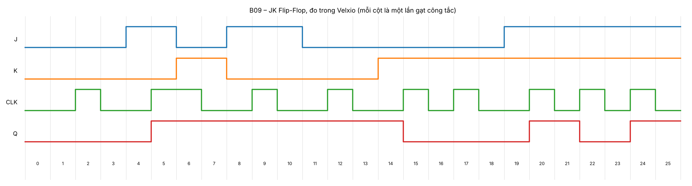
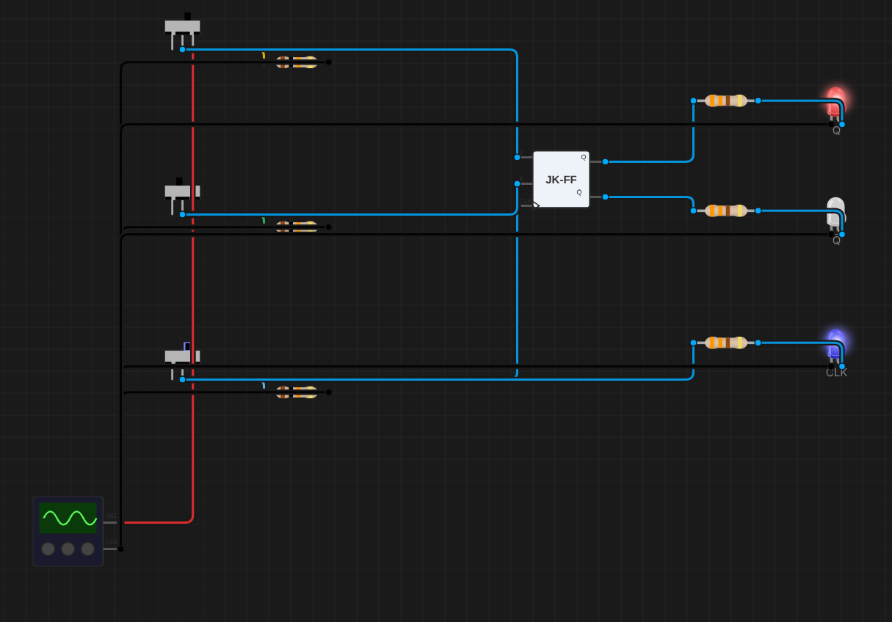
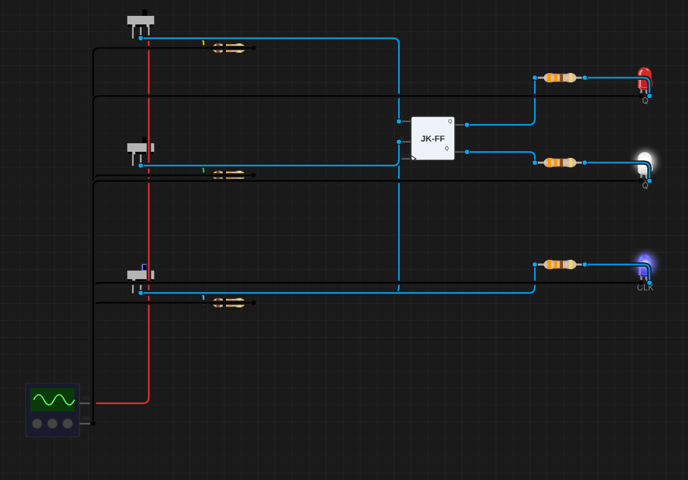

# B09 – Khảo sát JK Flip-Flop: 4 chế độ hoạt động

**Sinh viên:** Phạm Anh Quân – MSSV 2353011 · **Môn:** ĐATKLL – HCMUT

**Mức độ:** ★★ · **Nhóm linh kiện:** Nhóm 2 (JK Flip-Flop) · **Môi trường:** Velxio (digital gate engine)

| Thành phần | File |
|---|---|
| Project mô phỏng | `B09-JK-flip-flop.vlx` |
| Báo cáo PDF | `B09-JK-flip-flop.pdf` |
| Ảnh canvas, giản đồ thời gian | `img/` |
| Dữ liệu đo | `timing.json` |
| Script | `../tools/gen_b09.py`, `../tools/plot_timing.py` |

---

## 1. Mục tiêu

- Kiểm chứng 4 chế độ: giữ (J = K = 0), đặt (J = 1, K = 0), xóa (J = 0, K = 1), đảo (J = K = 1).
- Lập bảng đặc tính và bảng kích thích; viết phương trình đặc tính.
- Xác định JK của Velxio kích cạnh lên hay cạnh xuống.

## 2. Mạch

- Linh kiện `flip-flop-jk` của Velxio (chân J, K, CLK, Q, Q̄; không có PRE/CLR).
- Công tắc J (vàng), K (xanh lá), CLK (xanh dương) có pull-down 10 kΩ. CLK là clock tay.
- LED: Q đỏ, Q̄ trắng, LED xanh dương báo mức CLK.

Thống kê: 1 JK-FF, 3 công tắc, 6 điện trở, 3 LED; 14 linh kiện, 21 dây.

## 3. Trình tự thí nghiệm và kết quả

Mỗi bước là một lần gạt công tắc (Q trước = Q ở bước liền trước):

| Bước | Thao tác | J | K | CLK | Q | Ghi chú |
|---|---|---|---|---|---|---|
| 0 | khởi động | 0 | 0 | 0 | 0 | |
| 1 | J = 0, K = 0 | 0 | 0 | 0 | 0 | |
| 2 | CLK ↑ | 0 | 0 | 1 | 0 | **giữ** (Q = 0 → 0) |
| 3 | CLK ↓ | 0 | 0 | 0 | 0 | |
| 4 | J = 1 | 1 | 0 | 0 | 0 | chưa có cạnh: Q chưa đổi |
| 5 | CLK ↑ | 1 | 0 | 1 | **1** | **đặt** (0 → 1) |
| 6 | J = 0, K = 1 khi CLK = 1 | 0 | 1 | 1 | 1 | mức cao: không đổi |
| 7 | **CLK ↓** | 0 | 1 | 0 | **1** | **cạnh xuống không làm Q đổi** |
| 8 | J = 1, K = 0 | 1 | 0 | 0 | 1 | |
| 9 | CLK ↑ | 1 | 0 | 1 | 1 | **đặt** (1 → 1) |
| 10 | CLK ↓ | 1 | 0 | 0 | 1 | |
| 11 | J = 0, K = 0 | 0 | 0 | 0 | 1 | |
| 12 | CLK ↑ | 0 | 0 | 1 | 1 | **giữ** (1 → 1) |
| 13 | CLK ↓ | 0 | 0 | 0 | 1 | |
| 14 | K = 1 | 0 | 1 | 0 | 1 | |
| 15 | CLK ↑ | 0 | 1 | 1 | **0** | **xóa** (1 → 0) |
| 16 | CLK ↓ | 0 | 1 | 0 | 0 | |
| 17 | CLK ↑ | 0 | 1 | 1 | 0 | **xóa** (0 → 0) |
| 18 | CLK ↓ | 0 | 1 | 0 | 0 | |
| 19 | J = 1, K = 1 | 1 | 1 | 0 | 0 | |
| 20 | CLK ↑ | 1 | 1 | 1 | **1** | **đảo** (0 → 1) |
| 21 | CLK ↓ | 1 | 1 | 0 | 1 | |
| 22 | CLK ↑ | 1 | 1 | 1 | **0** | **đảo** (1 → 0) |
| 23 | CLK ↓ | 1 | 1 | 0 | 0 | |
| 24 | CLK ↑ | 1 | 1 | 1 | **1** | **đảo** (0 → 1) |
| 25 | CLK ↓ | 1 | 1 | 0 | 1 | |

Q̄ luôn ngược Q ở mọi bước.

### 3.1. Kích cạnh lên hay cạnh xuống?

- Q chỉ đổi ở các bước CLK ↑ (5, 15, 20, 22, 24) và không bao giờ đổi ở bước CLK ↓.
- Bước 6–7 là phép thử quyết định: đặt J = 0, K = 1 (lệnh xóa) trong lúc CLK = 1, rồi cho CLK ↓. Q vẫn = 1. Xóa chỉ xảy ra ở cạnh lên kế tiếp (bước 15).

⇒ **JK của Velxio kích cạnh lên** (giống 74HC74 dạng D, khác 74HC107/74HC112 kích cạnh xuống). Mã nguồn Velxio cũng ghi "hold/set/reset/toggle on rising CLK". Khi đọc datasheet 74HC107/112 để lắp mạch thật phải nhớ cạnh kích ngược lại.

| Đặt (bước 5) | Cạnh xuống không xóa (bước 7) | Xóa (bước 15) |
|---|---|---|
|  |  |  |
| **Đảo lần 1 (bước 20)** | **Đảo lần 2 (bước 22)** | |
|  |  | |

## 4. Bảng đặc tính (đo được)

| J | K | Q | Q⁺ (đo) | Bước | Chế độ |
|---|---|---|---|---|---|
| 0 | 0 | 0 | 0 | 2 | giữ |
| 0 | 0 | 1 | 1 | 12 | giữ |
| 0 | 1 | 0 | 0 | 17 | xóa |
| 0 | 1 | 1 | 0 | 15 | xóa |
| 1 | 0 | 0 | 1 | 5 | đặt |
| 1 | 0 | 1 | 1 | 9 | đặt |
| 1 | 1 | 0 | 1 | 20, 24 | đảo |
| 1 | 1 | 1 | 0 | 22 | đảo |

Cả 8 dòng khớp lý thuyết. Dạng rút gọn:

| J | K | Q⁺ |
|---|---|---|
| 0 | 0 | Q (giữ) |
| 0 | 1 | 0 (xóa) |
| 1 | 0 | 1 (đặt) |
| 1 | 1 | Q̄ (đảo) |

## 5. Phương trình đặc tính

Bìa Karnaugh của Q⁺ (hàng J, cột KQ theo mã Gray):

| J \ KQ | 00 | 01 | 11 | 10 |
|---|---|---|---|---|
| **0** | 0 | 1 | 0 | 0 |
| **1** | 1 | 1 | 0 | 1 |

- Nhóm {J=1, KQ = 00 và 10}: J·Q̄
- Nhóm {KQ = 01, J = 0 và 1}: K̄·Q

⇒ **Q⁺ = J·Q̄ + K̄·Q**

## 6. Bảng kích thích (excitation table)

Muốn Q chuyển từ Q sang Q⁺ thì cần J, K bằng bao nhiêu (X = tùy ý):

| Q | Q⁺ | J | K | Lý do |
|---|---|---|---|---|
| 0 | 0 | 0 | X | giữ (J=0,K=0) hoặc xóa (J=0,K=1) đều cho 0 |
| 0 | 1 | 1 | X | đặt (1,0) hoặc đảo (1,1) đều cho 1 |
| 1 | 0 | X | 1 | xóa (0,1) hoặc đảo (1,1) |
| 1 | 1 | X | 0 | giữ (0,0) hoặc đặt (1,0) |

Mỗi chuyển trạng thái có một biến tùy ý X, nên khi thiết kế bộ đếm đồng bộ (C05) bìa K của J, K có nhiều ô X để rút gọn. Đây là lý do JK thường cho mạch tổ hợp đơn giản hơn D-FF.

## 7. Race-around (tham khảo)

Với JK **kích mức** (latch), khi J = K = 1 và CLK = 1 kéo dài hơn trễ lan truyền, Q sẽ đảo liên tục nhiều lần trong một xung clock (**race-around**). JK kích cạnh (như trong Velxio) hoặc master–slave tránh được hiện tượng này vì mỗi cạnh chỉ cập nhật một lần. Bước 20–24 cho thấy mỗi cạnh lên đảo đúng một lần.

## 8. Tài liệu tham khảo

- M. Morris Mano, *Digital Design*, chương 5 (JK flip-flop, characteristic/excitation table).
- Nexperia, *74HC107 Dual JK flip-flop with reset; negative-edge trigger*, datasheet.
- Velxio, mã nguồn `FlipFlopElements.ts`, `digitalGateEngine.ts`.
