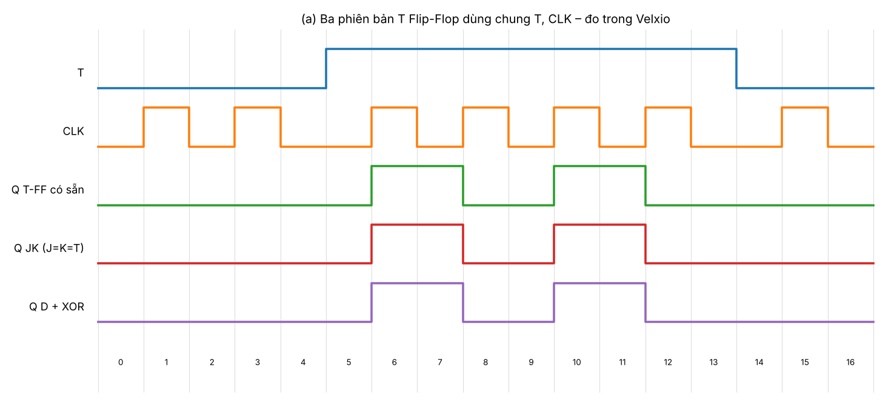
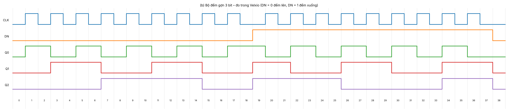
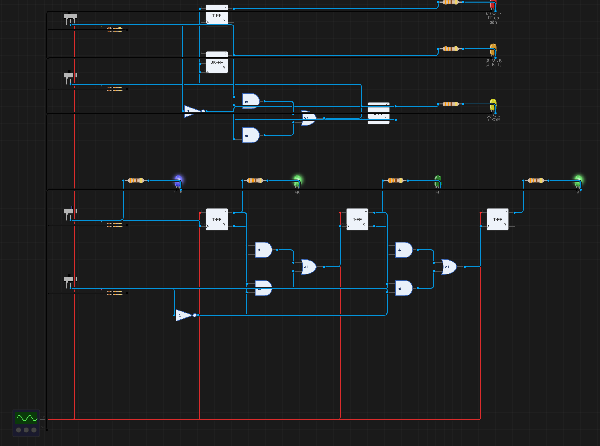
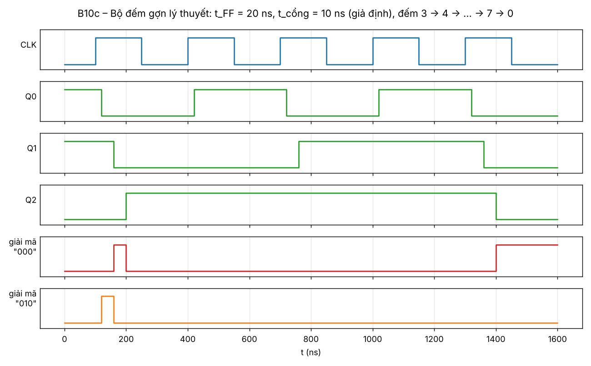

# B10 – T Flip-Flop và bộ đếm gợn (ripple counter) 3 bit

**Sinh viên:** Phạm Anh Quân – MSSV 2353011 · **Môn:** ĐATKLL – HCMUT

**Mức độ:** ★★★ · **Nhóm linh kiện:** Nhóm 2 (T, JK, D Flip-Flop; cổng AND, OR, NOT) · **Môi trường:** Velxio (digital gate engine)

| Thành phần | File |
|---|---|
| Project mô phỏng (phần a và b trên cùng canvas) | `B10-T-FF-dem-gon.vlx` |
| Báo cáo PDF | `B10-T-FF-dem-gon.pdf` |
| Ảnh canvas, giản đồ | `img/` |
| Dữ liệu đo | `timing_a.json`, `timing_b.json` |
| Script | `../tools/gen_b10.py` (mạch), `../tools/plot_timing.py`, `../tools/plot_b10_ripple.py` (giản đồ trễ) |

---

## 1. Mục tiêu

- (a) Tạo T Flip-Flop bằng 2 cách (JK với J = K = T; D với D = T ⊕ Q, XOR dựng từ AND, OR, NOT) và so sánh với T-FF có sẵn.
- (b) Nối 3 T-FF thành bộ đếm gợn 3 bit 0 → 7, hiển thị bằng 3 LED; giải thích cách đếm xuống.
- (c) Phân tích trễ tích lũy từ clock tới bit cao nhất và glitch khi giải mã trạng thái.

## 2. (a) Ba phiên bản T Flip-Flop

### 2.1. Thiết kế

T-FF: Q⁺ = T ⊕ Q (T = 0 giữ, T = 1 đảo).

| Phiên bản | Cách dựng | Chứng minh |
|---|---|---|
| T-FF có sẵn | `flip-flop-t` của Velxio | – |
| Từ JK | J = K = T | Q⁺ = J·Q̄ + K̄·Q = T·Q̄ + T̄·Q = T ⊕ Q |
| Từ D | D = T ⊕ Q = T·Q̄ + T̄·Q | Q⁺ = D = T ⊕ Q |

Với bản dùng D: lấy Q̄ có sẵn ở ngõ ra D-FF làm "NOT Q", nên XOR chỉ cần **1 NOT (T̄) + 2 AND + 1 OR**:

```
T ──┬──────────── AND ── T·Q̄ ──┐
    │   Q̄ (D-FF) ─┘             OR ── D ──► D-FF ──► Q
    └─ NOT ─ T̄ ── AND ── T̄·Q ──┘          ▲
            Q (D-FF) ─┘                    CLK
```

Ba FF dùng chung công tắc T và CLKa (cột trái, hai công tắc trên cùng). LED: T-FF có sẵn (đỏ), JK (cam), D + XOR (vàng).

### 2.2. Kết quả

| Bước | Thao tác | T | Q T-FF | Q JK | Q D+XOR |
|---|---|---|---|---|---|
| 0 | khởi động | 0 | 0 | 0 | 0 |
| 1, 3 | CLK ↑ (2 lần) | 0 | 0 | 0 | 0 |
| 6 | CLK ↑ | 1 | 1 | 1 | 1 |
| 8 | CLK ↑ | 1 | 0 | 0 | 0 |
| 10 | CLK ↑ | 1 | 1 | 1 | 1 |
| 12 | CLK ↑ | 1 | 0 | 0 | 0 |
| 15 | CLK ↑ | 0 | 0 | 0 | 0 |



**Kết luận:** ở cả 17 bước, ba LED luôn giống nhau. T = 0 thì giữ, T = 1 thì đảo ở mỗi cạnh lên, nên **hai phiên bản tự dựng hoạt động đúng như T-FF có sẵn**. Cả ba đều kích cạnh lên (theo linh kiện gốc của Velxio).


## 3. (b) Bộ đếm gợn 3 bit

### 3.1. Nguyên lý

- Mọi T-FF có T = 1 (nối +5 V), nên mỗi cạnh clock đảo một lần (chia 2 như B08c).
- Tầng 0 nhận clock ngoài (công tắc CLKr). **Ngõ ra tầng trước làm clock tầng sau**, mỗi tầng chia đôi tần số nên Q2Q1Q0 đếm nhị phân.
- Bit Qi+1 phải đảo khi Qi **rơi 1 → 0** (đếm lên: 0**1**1 → **1**00). FF trong Velxio kích **cạnh lên**, mà Qi rơi tương ứng với **Q̄i lên**, nên **lấy Q̄i làm clock tầng sau để đếm lên**. (Với FF kích cạnh xuống như 74HC107/112 thì ngược lại, lấy Qi.)

### 3.2. Cách sửa để đếm xuống

Đếm xuống (100 → 011): Qi+1 đảo khi Qi **lên 0 → 1** ⇒ với FF kích cạnh lên, lấy **Qi** làm clock tầng sau. Tóm tắt:

| Loại FF | Đếm lên: clock tầng sau | Đếm xuống: clock tầng sau |
|---|---|---|
| Kích cạnh lên (Velxio, 74HC74) | Q̄i | Qi |
| Kích cạnh xuống (74HC107/112) | Qi | Q̄i |

Project có công tắc **DN** chọn chiều đếm bằng bộ chọn 2 → 1 dựng từ cổng:

CLK(i+1) = DN̄·Q̄i + DN·Qi (1 NOT dùng chung + mỗi tầng 2 AND + 1 OR).

Thống kê toàn project: 6 FF, 11 cổng, 4 công tắc, 11 điện trở, 7 LED; 40 linh kiện, 66 dây.

### 3.3. Kết quả

| Lần nhấn CLK | 1 | 2 | 3 | 4 | 5 | 6 | 7 | 8 | 9 |
|---|---|---|---|---|---|---|---|---|---|
| Đếm lên (DN = 0), Q2Q1Q0 | 001 | 010 | 011 | 100 | 101 | 110 | 111 | **000** | 001 |
| Đếm xuống (DN = 1), Q2Q1Q0 | 110 | 101 | 100 | 011 | 010 | 001 | 000 | **111** | 110 |

Bộ đếm đếm đúng 0 → 7 rồi quay vòng về 0, và đếm xuống đúng 7 → 0 rồi quay về 7.



| Đếm lên: 5 (101) | Đếm lên: 7 (111) | Đếm xuống: 4 (100) |
|---|---|---|
|  |  |  |

**Phát hiện khi đổi chiều đếm:** gạt DN lúc đang đếm làm bộ đếm **nhảy sai** (đo được: đang ở 1 = 001, gạt DN = 1 thì nhảy thành 7 = 111; đang ở 6 = 110, gạt DN = 0 thì nhảy thành 0 = 000).

Nguyên nhân: tại 001, clock tầng 1 đang là Q̄0 = 0. Gạt DN chuyển sang Q0 = 1, tạo ra một **cạnh lên giả** nên FF1 đảo. FF1 đảo lại tạo cạnh lên giả cho FF2. Đây chính là điểm yếu của việc dùng ngõ ra FF (qua mạch tổ hợp) làm clock. Cách khắc phục: chỉ đổi DN khi đã khóa clock, hoặc dùng bộ đếm đồng bộ lên/xuống (C05), nơi mọi FF dùng chung một clock và DN chỉ đi vào ngõ vào dữ liệu.

## 4. (c) Trễ tích lũy và glitch giải mã

Bộ mô phỏng số của Velxio **không có trễ**: mọi FF đổi trong cùng một bước tính, nên không quan sát được hiện tượng gợn. Phần này phân tích bằng tính toán.

### 4.1. Trễ cộng dồn

Gọi t_FF là trễ CLK → Q của một FF, t_G là trễ một cổng. Trong mạch này, giữa hai tầng có bộ chọn AND–OR (2 cổng):

- Q0 đổi sau t_FF
- Q1 đổi sau t_FF + 2t_G + t_FF
- Q2 đổi sau **3·t_FF + 4·t_G**

Tổng quát, bộ đếm gợn n bit có trễ tới bit cao nhất ≈ **n·t_FF** (cộng thêm trễ bộ chọn nếu có), tăng tuyến tính theo số bit. Với giá trị giả định t_FF = 20 ns, t_G = 10 ns (bậc độ lớn của 74HC ở 4,5 V, cần đối chiếu datasheet), Q2 đổi chậm 3·20 + 4·10 = **100 ns** sau cạnh clock.

Hệ quả: chu kỳ clock phải lớn hơn trễ cộng dồn cộng thời gian setup của mạch đọc kết quả. Nếu không, bộ đếm chưa kịp ổn định đã có cạnh mới.

### 4.2. Glitch khi giải mã trạng thái

Script `tools/plot_b10_ripple.py` mô phỏng các trễ trên cho chuỗi đếm 3 → 4 → … → 7 → 0:

| t (ns) | Q2Q1Q0 | Ghi chú |
|---|---|---|
| 0 | 011 (3) | |
| 100 | – | cạnh lên CLK |
| 120 | 010 (2) | Q0 đã đổi, Q1 chưa: **trạng thái giả** |
| 160 | 000 (0) | Q1 đã đổi, Q2 chưa: **trạng thái giả** |
| 200 | 100 (4) | ổn định |
| 1320 | 110 (6) | từ 7, trạng thái giả |
| 1360 | 100 (4) | trạng thái giả |
| 1400 | 000 (0) | ổn định |



Chuyển 3 → 4 đi qua 2 → 0 → 4. Một bộ giải mã AND cho trạng thái "000" sẽ phát ra **xung giả 40 ns** (160–200 ns) dù bộ đếm không hề dừng ở 0. Bộ giải mã "010" cũng có xung giả 40 ns. Nếu xung này đưa vào ngõ vào bất đồng bộ (ví dụ CLR để reset bộ đếm mod-N) hoặc làm clock cho mạch khác, mạch sẽ hoạt động sai.

Cách khắc phục: dùng **bộ đếm đồng bộ** (mọi FF chung clock, C05), hoặc chỉ đọc/giải mã khi bộ đếm đã ổn định (strobe sau cạnh clock một khoảng lớn hơn trễ tích lũy), hoặc chốt kết quả giải mã bằng FF.

## 5. Tài liệu tham khảo

- M. Morris Mano, *Digital Design*, chương 6 (ripple counter, synchronous counter).
- Nexperia, *74HC74*, *74HC107* datasheet (trễ CLK → Q).
- Velxio, mã nguồn `FlipFlopElements.ts`, `digitalGateEngine.ts`.

## Video demo

[Video demo local](video/B10-demo.mp4) — 174,67 s, H.264, 1880×944. Quay Velxio thật 55 trạng thái: ba phiên bản T-FF giữ khi T=0, đảo khi T=1; bộ đếm gợn chín cạnh lên mỗi chiều, đủ vòng đếm lên/xuống. Video giữ và ghi phụ đề hiện tượng đổi DN gây nhảy 001 → 111 và 110 → 000 như mục 3.3. Con trỏ di chuyển mượt, gần thẳng và rung nhẹ; seed 6010.
