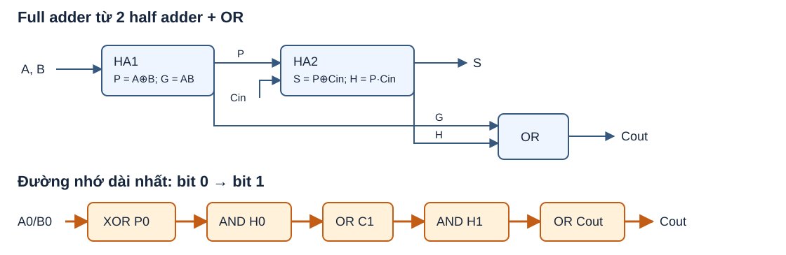
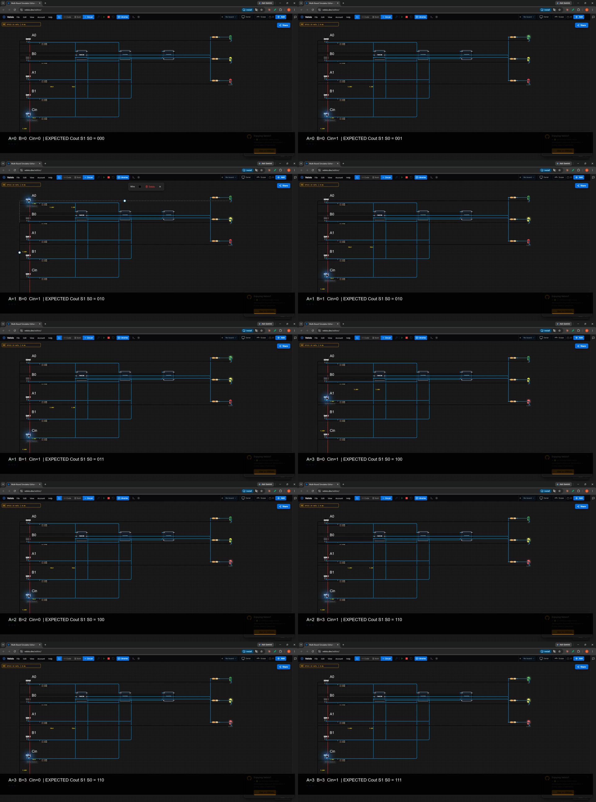
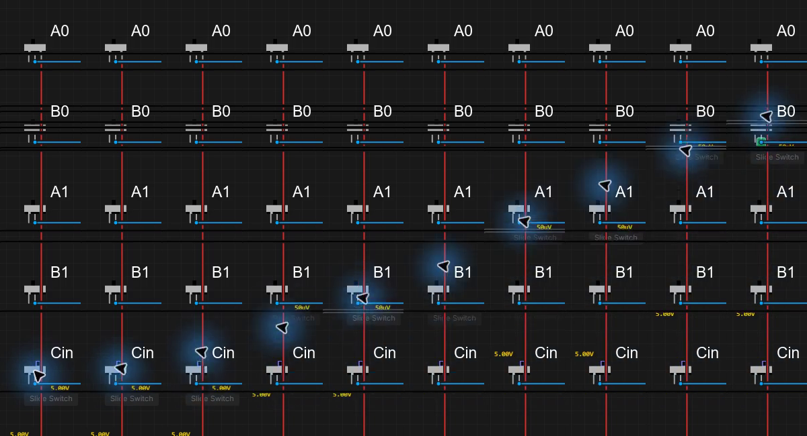

# C01 — Bộ cộng 2 bit

## Mục tiêu

Dùng 74HC86, 74HC08 và 74HC32 xây hai full adder (FA) từ hai half adder (HA) và một OR; ghép thành bộ cộng A1A0 + B1B0 + Cin, hiển thị S1, S0, Cout trên ba LED.

## Lý thuyết và thiết kế

HA nhận X, Y và tạo P = X ⊕ Y, G = X·Y. FA gồm HA1 nhận A, B tạo P, G; HA2 nhận P, Cin tạo S = P ⊕ Cin, H = P·Cin; OR tạo Cout = G + H. Hai FA nối tiếp: carry FA bit 0 là C1 vào FA bit 1.

- XOR: `xor` (74HC86), các cổng 1–2 cho bit 0, 3–4 cho bit 1.
- AND: `and` (74HC08), các cổng 1–2 cho bit 0, 3–4 cho bit 1.
- OR: `or` (74HC32), cổng 1 và 2 tương ứng C1 và Cout; đầu vào hai cổng dư nối GND.
- 5 công tắc A0, B0, A1, B1, Cin có pull-down 10 kΩ; mỗi LED S0, S1, Cout có điện trở 330 Ω nối tiếp. Nguồn công tắc 5 V; IC nối GND, chân VCC để Velxio cấp nội bộ theo quy ước B01.

Mở `C01-cong-2bit.vlx` trong Velxio. Tạo lại và kiểm tra logic bằng `python tools/gen_c01.py C01-cong-2bit/C01-cong-2bit.vlx` từ thư mục repo. Bộ kiểm tra truy ngược dây từ đầu vào điện trở LED đến chân cổng và công tắc, tính 32 tổ hợp và so sánh với phép cộng số nguyên. Kiểm tra này không thay thế chạy mô phỏng Velxio.

<div style="page-break-before: always"></div>

## Bảng chân trị

| A1 | A0 | B1 | B0 | Cin | Cout | S1 | S0 |
|---:|---:|---:|---:|---:|---:|---:|---:|
| 0 | 0 | 0 | 0 | 0 | 0 | 0 | 0 |
| 0 | 0 | 0 | 0 | 1 | 0 | 0 | 1 |
| 0 | 0 | 0 | 1 | 0 | 0 | 0 | 1 |
| 0 | 0 | 0 | 1 | 1 | 0 | 1 | 0 |
| 0 | 0 | 1 | 0 | 0 | 0 | 1 | 0 |
| 0 | 0 | 1 | 0 | 1 | 0 | 1 | 1 |
| 0 | 0 | 1 | 1 | 0 | 0 | 1 | 1 |
| 0 | 0 | 1 | 1 | 1 | 1 | 0 | 0 |
| 0 | 1 | 0 | 0 | 0 | 0 | 0 | 1 |
| 0 | 1 | 0 | 0 | 1 | 0 | 1 | 0 |
| 0 | 1 | 0 | 1 | 0 | 0 | 1 | 0 |
| 0 | 1 | 0 | 1 | 1 | 0 | 1 | 1 |
| 0 | 1 | 1 | 0 | 0 | 0 | 1 | 1 |
| 0 | 1 | 1 | 0 | 1 | 1 | 0 | 0 |
| 0 | 1 | 1 | 1 | 0 | 1 | 0 | 0 |
| 0 | 1 | 1 | 1 | 1 | 1 | 0 | 1 |
| 1 | 0 | 0 | 0 | 0 | 0 | 1 | 0 |
| 1 | 0 | 0 | 0 | 1 | 0 | 1 | 1 |
| 1 | 0 | 0 | 1 | 0 | 0 | 1 | 1 |
| 1 | 0 | 0 | 1 | 1 | 1 | 0 | 0 |
| 1 | 0 | 1 | 0 | 0 | 1 | 0 | 0 |
| 1 | 0 | 1 | 0 | 1 | 1 | 0 | 1 |
| 1 | 0 | 1 | 1 | 0 | 1 | 0 | 1 |
| 1 | 0 | 1 | 1 | 1 | 1 | 1 | 0 |
| 1 | 1 | 0 | 0 | 0 | 0 | 1 | 1 |
| 1 | 1 | 0 | 0 | 1 | 1 | 0 | 0 |
| 1 | 1 | 0 | 1 | 0 | 1 | 0 | 0 |
| 1 | 1 | 0 | 1 | 1 | 1 | 0 | 1 |
| 1 | 1 | 1 | 0 | 0 | 1 | 0 | 1 |
| 1 | 1 | 1 | 0 | 1 | 1 | 1 | 0 |
| 1 | 1 | 1 | 1 | 0 | 1 | 1 | 0 |
| 1 | 1 | 1 | 1 | 1 | 1 | 1 | 1 |



## Đường lan truyền nhớ dài nhất

Đường cấu trúc dài nhất từ A0 hoặc B0 tới Cout:

```text
A0/B0 → XOR (P0) → AND (P0·Cin) → OR (C1)
      → AND (P1·C1) → OR (Cout)
```

Với P1 = 1 và Cin = 1, một chuyển đổi A0/B0 thích hợp có thể lan theo đường này. Tại 4,5 V, 25 °C, tải CL = 50 pF, bảng switching characteristics của Texas Instruments cho tpd điển hình/tối đa (cùng ở trang 6; các mục 6.6, 5.7 và 6.8 tương ứng): [SN74HC86](https://www.ti.com/lit/ds/symlink/sn74hc86.pdf) 12/20 ns; [SN74HC08](https://www.ti.com/lit/ds/symlink/sn74hc08.pdf) 10/20 ns; [SN74HC32](https://www.ti.com/lit/ds/symlink/sn74hc32.pdf) 10/20 ns. Cộng các tầng được ước lượng điển hình **12 + 2×10 + 2×10 = 52 ns**, hoặc tổng giới hạn từng cổng **5×20 = 100 ns** ở điều kiện bảng. Đây là ước lượng tĩnh, không phải kết quả đo; tải thực tế, dây, chuyển mức và nhiệt độ ảnh hưởng độ trễ. Nguồn mô phỏng dùng 5 V, trong khi ước lượng lấy điểm datasheet 4,5 V.

## Mở rộng 4 bit

Thêm FA bit 2 và bit 3 cùng cấu trúc; nối Cout bit 1 → Cin bit 2, Cout bit 2 → Cin bit 3. Đưa A2/B2 và A3/B3 vào hai tầng, lấy S2/S3 và Cout cuối. Đây là ripple-carry: đường nhớ tăng thêm hai cổng AND/OR cho mỗi tầng, vì vậy độ trễ tăng theo số bit.

## Mô phỏng và thực tế

Velxio cấp VCC nội bộ cho IC; lắp mạch thật phải cấp đúng chân VCC/GND, thêm tụ decoupling gần từng IC, nối mức xác định cho đầu vào cổng dư và kiểm tra khả năng dòng LED theo datasheet. Đã nạp project trên Velxio và đối chiếu trực quan 10 tổ hợp trong video; kiểm tra Boolean từ dây nối bao phủ đủ 32/32. Chưa đo trên phần cứng thật. Báo cáo PDF: `C01-cong-2bit.pdf`.


## Video demo và cách quay lại

[Video local C01-demo.mp4](video/C01-demo.mp4): 57,966667 giây, 1920×1032, 30 fps (ffprobe). Đã giải mã toàn bộ bằng ffmpeg không lỗi. Nhãn EXPECTED là đáp án tính trước; LED trên canvas là đầu ra mô phỏng được quan sát. Mười tổ hợp: (A,B,Cin) = (0,0,0), (0,0,1), (1,0,1), (1,1,0), (1,1,1), (3,0,1), (2,2,0), (2,3,1), (3,3,0), (3,3,1), giữ khoảng 3 giây mỗi tổ hợp. Ba LED từ trên xuống: S0, S1, Cout.





Script dùng Desktop Duplication (`ddagrab`) để bắt con trỏ đúng; thử `gdigrab` ban đầu có con trỏ đứng hình. Chuột được điều khiển qua 40 điểm easing, thời gian đặt 600 ms; thời gian thực có thể dài hơn vì lịch xử lý Windows. Không dịch chuyển tức thời giữa công tắc.

Quay lại bằng PowerShell 7, với ffmpeg có sẵn: mở file .vlx, phóng to Chrome trên màn hình 1920×1080 / 100%, chọn Circuit, thu gọn AI, bấm Reset view (100%). Công tắc từ trên xuống A0, B0, A1, B1, Cin; truyền đúng trạng thái đang có (project mới nạp đều 0). Không di chuyển chuột hoặc đổi cửa sổ khi quay.

```powershell
pwsh -File tools/record_demo.ps1 -InitialA 0 -InitialB 0 -InitialCin 0 -Output C01-cong-2bit/video/C01-demo-new.mp4
```

Script không ghi đè video đích đã có; các file phụ caption/progress/log trong `video/` được dùng lại. `cases.log` ghi thời điểm theo đồng hồ sau khi xác nhận ffmpeg đã bắt được khung hình đầu, không phải timestamp tuyệt đối của video. Các bản take1/take2/dda-partial được giữ để không xóa file; dùng C01-demo.mp4 làm bản chính. Video chưa upload hoặc push.
