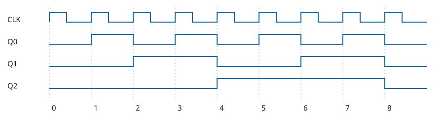

<style>
h2, h3 { break-after: avoid; page-break-after: avoid; }
table { break-inside: avoid; page-break-inside: avoid; }
</style>

# C05 — Bộ đếm đồng bộ 3 bit dùng JK

## Thiết kế

Ba JK flip-flop Nhóm 2 chung clock, đếm lên modulo 8 tại cạnh lên khi E=1. E=0 giữ nguyên trạng thái. CLK là công tắc trên cùng; E ở dưới, mặc định 1. Ba LED theo thứ tự Q0, Q1, Q2.

```text
E ───────────→ J0,K0      CLK ──┬──→ FF0 → Q0
E·Q0 ────────→ J1,K1           ├──→ FF1 → Q1
E·Q0·Q1 ─────→ J2,K2           └──→ FF2 → Q2
```

Vì JK đảo khi J=K=1 và giữ khi cả hai bằng 0: `J0=K0=E`, `J1=K1=E·Q0`, `J2=K2=E·Q0·Q1`. Hai cổng AND hai ngõ vào tạo E·Q0 rồi E·Q0·Q1; ba FF nhận cùng CLK. Các công tắc có pull-down 10 kΩ; mỗi LED có điện trở 330 Ω.

## Bảng kích thích JK

| Q | Q⁺ | J | K |
|:-:|:-:|:-:|:-:|
| 0 | 0 | 0 | X |
| 0 | 1 | 1 | X |
| 1 | 0 | X | 1 |
| 1 | 1 | X | 0 |

X là không quan tâm. Từ bảng này lập bản đồ Karnaugh từng J, K dưới đây; cùng chọn các ô X để rút gọn thành các biểu thức trên.

<div style="page-break-before: always"></div>

## Bảng trạng thái

| Q2Q1Q0 | E=0: Q2⁺Q1⁺Q0⁺ | E=1: Q2⁺Q1⁺Q0⁺ |
|:---:|:---:|:---:|
| 000 | 000 | 001 |
| 001 | 001 | 010 |
| 010 | 010 | 011 |
| 011 | 011 | 100 |
| 100 | 100 | 101 |
| 101 | 101 | 110 |
| 110 | 110 | 111 |
| 111 | 111 | 000 |

## Bản đồ Karnaugh

Mỗi bản đồ có hai lớp E=0 và E=1; hàng Q2, cột Q1Q0 theo Gray 00, 01, 11, 10. Mỗi ô là giá trị kích thích JK yêu cầu; X là không quan tâm theo bảng kích thích.

### J0

| E | Q2 \ Q1Q0 | 00 | 01 | 11 | 10 |
|:-:|:-:|:-:|:-:|:-:|:-:|
| 0 | 0 | 0 | X | X | 0 |
| 0 | 1 | 0 | X | X | 0 |
| 1 | 0 | 1 | X | X | 1 |
| 1 | 1 | 1 | X | X | 1 |

### K0

| E | Q2 \ Q1Q0 | 00 | 01 | 11 | 10 |
|:-:|:-:|:-:|:-:|:-:|:-:|
| 0 | 0 | X | 0 | 0 | X |
| 0 | 1 | X | 0 | 0 | X |
| 1 | 0 | X | 1 | 1 | X |
| 1 | 1 | X | 1 | 1 | X |

### J1

| E | Q2 \ Q1Q0 | 00 | 01 | 11 | 10 |
|:-:|:-:|:-:|:-:|:-:|:-:|
| 0 | 0 | 0 | 0 | X | X |
| 0 | 1 | 0 | 0 | X | X |
| 1 | 0 | 0 | 1 | X | X |
| 1 | 1 | 0 | 1 | X | X |

### K1

| E | Q2 \ Q1Q0 | 00 | 01 | 11 | 10 |
|:-:|:-:|:-:|:-:|:-:|:-:|
| 0 | 0 | X | X | 0 | 0 |
| 0 | 1 | X | X | 0 | 0 |
| 1 | 0 | X | X | 1 | 0 |
| 1 | 1 | X | X | 1 | 0 |

### J2

| E | Q2 \ Q1Q0 | 00 | 01 | 11 | 10 |
|:-:|:-:|:-:|:-:|:-:|:-:|
| 0 | 0 | 0 | 0 | 0 | 0 |
| 0 | 1 | X | X | X | X |
| 1 | 0 | 0 | 0 | 1 | 0 |
| 1 | 1 | X | X | X | X |

### K2

| E | Q2 \ Q1Q0 | 00 | 01 | 11 | 10 |
|:-:|:-:|:-:|:-:|:-:|:-:|
| 0 | 0 | X | X | X | X |
| 0 | 1 | 0 | 0 | 0 | 0 |
| 1 | 0 | X | X | X | X |
| 1 | 1 | 0 | 0 | 1 | 0 |

<div style="page-break-before: always"></div>

## Giản đồ và so sánh



Giản đồ thể hiện kết quả lý tưởng từ logic netlist, E=1 và trạng thái đầu 000; các bit đổi cùng cạnh trong mô hình, không phải số liệu đo. Chuỗi 000 → 001 → 010 → 011 → 100 → 101 → 110 → 111 → 000. E=0 giữ trạng thái qua cạnh lên.

B10 là bộ đếm gợn: tầng trước cấp clock cho tầng sau, nên trễ lan qua từng tầng trên phần cứng. C05 cấp clock chung; các FF nhận cùng cạnh nhưng phần cứng thực vẫn có trễ clock-to-Q khác nhau, skew và trễ tổ hợp, có thể phát sinh glitch ngắn. Không có số đo độ trễ cho C05.

## Kiểm chứng và thực tế

Chạy `python tools/gen_c05.py C05-dem-dong-bo-JK/C05-dem-dong-bo-JK.vlx` từ thư mục repo. Script lưu và đọc lại file bằng `vlx_extra.Circuit`, cấp từng trạng thái 0–7, kiểm E=0/1 và ba chuyển clock 0→1, 1→1, 1→0: 48 trường hợp; kiểm cả ba chân clock nhận mức chung. Các kết quả dùng trạng thái được cấp cho bộ kiểm tra, không chứng minh trạng thái khởi động vật lý. Chuỗi kiểm tra bắt đầu từ trạng thái 0 được cấp cho bộ kiểm chứng; trạng thái khi nạp Velxio cần quan sát. Phần cứng thật cần cơ chế khởi tạo/reset phù hợp và chống dội nút clock. Chưa chạy Velxio hoặc quay video cho C05.
